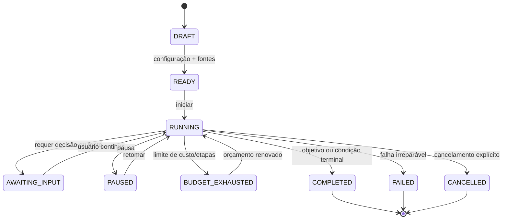
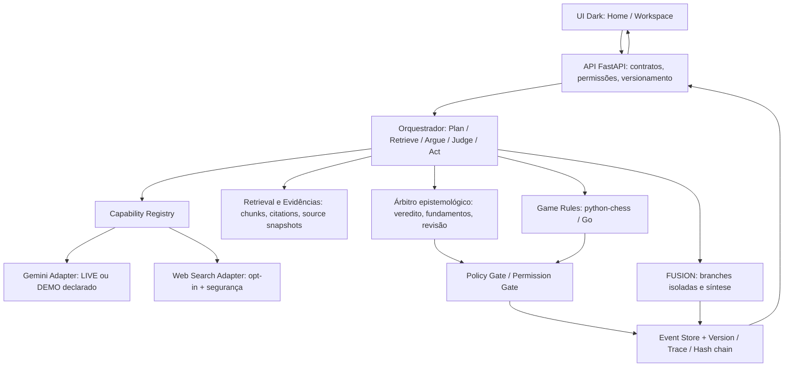
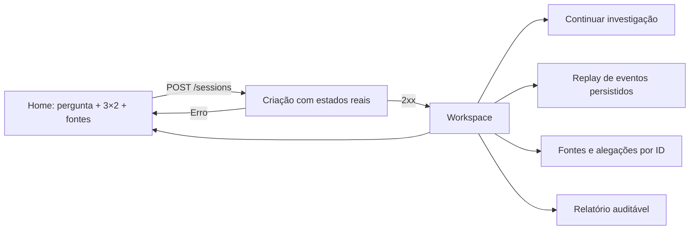

# GAMBIT LAB — Auditoria de produto, arquitetura e plano de reengenharia

**Versão:** R1.0 · **Data:** 31/10/2026 · **Escopo:** plataforma Pesquisa / Debate / Auditoria × Xadrez / Go, FUSION, Gemini, fontes, tabuleiro 3D e rastreabilidade.  
**Classificação:** documento técnico para revisão e execução pelo Antigravity. **Não constitui auditoria executada do repositório atual**: nesta revisão foram inspecionadas as duas capturas enviadas, os relatórios fornecidos e a especificação Gambit Lab 2.0; o código-fonte atualizado do backend/frontend não foi anexado. Todas as hipóteses de causa devem ser comprovadas no código, nos logs e em testes.

## 1. Diagnóstico executivo

**Decisão:** **reengenharia seletiva em vez de reescrita total**. Preservar motores de regras, Event Store, API, contratos de dados, integração Gemini, testes e cenas WebGL quando corretos. Corrigir contratos e fluxos defeituosos; refazer a camada visual e a orquestração quando necessário.

| ID | Evidência / sintoma | Situação | Severidade | Comprovação necessária |
|---|---|---|---|---|
| AUD-01 | O seletor apresenta “Web + arquivos (planejado/em dev)” e não permite iniciar pesquisa pública | **Observado** na captura | P0 para o escopo que inclui Web; P1 se MVP for assumidamente `own_only` | Inspecionar capability flags, formulário, política no schema e ferramentas de busca reais |
| AUD-02 | O workspace permanece em “Lance 3 / 3” | **Observado** na captura | P0 | Distinguir roteiro DEMO de execução dinâmica; localizar arrays, limites e ações `/advance` |
| AUD-03 | A interface informa “Gemini Adapter”, 12 ms, custo $0 e três selos aprovados | **Observado** na captura; execução Gemini **não comprovada** | P0 | Evidências de chamadas reais, usage metadata, fontes, IDs de decisão e modo de sessão |
| AUD-04 | Pergunta sobre eleição de 2030 recebe explicação sobre hashes e gambitos sem conclusão temática | **Observado** na captura, possível conteúdo demonstrativo | P0 | Trace de retrieval, prompts, claims e resposta efetiva por pergunta |
| AUD-05 | Tema “Cosmic” é majoritariamente azul-marinho, com estrela/planeta concorrendo com o tabuleiro | **Observado** | P1 | Implementar novo sistema de design e testar contraste/percepção |
| AUD-06 | Barra de entrada some após enviar, mas o workspace ocupa muita altura e espalha funções | **Observado** | P1 | User journeys desktop/mobile, medidas de scroll e interação |
| AUD-07 | Ferramentas 3D/2D, replay, upload e FUSION citadas como implementadas | **Relatado**, não auditado no código nesta sessão | P0 de verificação | Provas E2E com persistência real e logs/capturas |
| AUD-08 | 37 testes passaram; teste Gemini real ainda exigia chave | **Relatado** | P0 | Executar suíte, confirmar `skipped`, fazer integração real separada e sem divulgar chave |

**Regra de apresentação:** nunca converter um “serviço conectado” em afirmação de “pesquisa concluída”. Os estados de **API acessível**, **modelo invocado**, **fontes recuperadas**, **citações localizadas** e **alegações sustentadas** são diferentes.

## 2. Objetivo de produto e escopo definitivo

O usuário entra com uma pergunta ou problema, escolhe **modalidade** (`research`, `debate`, `audit`), **jogo** (`chess`, `go`), estratégia, fontes e orçamento. A sessão passa por etapas observáveis, produz pesquisa com evidências, movimentação real confirmada pelo motor, argumentos e um relatório auditável. O usuário pode interromper, continuar, revisar e reproduzir o processo.

### 2.1 Matriz 3 × 2 — invariantes de produto

| Modalidade | Xadrez | Go |
|---|---|---|
| Pesquisa | Aberturas/gambitos governam **presets de estratégia**, não o valor de verdade; lances legais; pesquisas por etapas | Regiões e grupos visualizam domínios de investigação, sem afirmar que território comprova a hipótese |
| Debate | Lados com acervos separados; brancas iniciam; contestação argumentativa ligada a ação legal | Pretas iniciam; captura é **espacial**; contestação factual existe em camada separada |
| Auditoria | Peças e lances vinculados a controles, testes e riscos | Regiões vinculadas a requisitos, não conformidades, evidência e cobertura |

**FUSION:** executar 2–3 ramos de investigação em **sessões/estados isolados**, deduplicar URLs/arquivos por identificador estável, comparar escopos e sintetizar resultados com desacordos explícitos. Não juntar FEN/SGF incompatíveis. Evolução cross-game só após FUSION no mesmo jogo funcionar.

## 3. Correção P0-A — Pesquisa Web funcional, com permissão explícita

### 3.1 Diagnóstico possível (não comprovado)

1. Select tem `<option>` de Web, mas o código a bloqueia explicitamente por estar planejado.
2. Frontend envia `web_opt_in`, mas backend/schema só aceita `own_only` ou ignora o campo.
3. Backend tem política de acesso, porém **não existe provedor de busca** nem coletor de páginas.
4. Gemini está disponível para texto, mas nenhum mecanismo de grounding/busca foi configurado; uma chave Gemini isolada **não garante** a pesquisa Web.
5. O endpoint existe mas não está anunciado nas capacidades (`GET /capabilities`) ou falha por credencial, limite, permissão, timeout ou CORS.

### 3.2 Projeto recomendado

**Opções de fonte explícitas:**
- `OWN_ONLY` — fontes anexadas e autorizadas; **nenhum conector de busca pública**. Observação: usar Gemini por API ainda transmite conteúdo autorizado ao provedor; isso não é execução offline.
- `WEB_ONLY` — buscar apenas fontes públicas; exige aceite informado para consultas externas.
- `HYBRID` — anexos + Web; citações identificam claramente a origem.

**Habilitação baseada em capacidade real:** `GET /api/v1/capabilities` retorna `web_search:{available,provider,reason}` e `gemini:{configured,live_allowed}`. Se não houver provedor de busca funcional, o botão aparece **desativado com explicação**, nunca como se estivesse pronto. Ao implementar, habilitar somente após smoke-test real do provedor escolhido e sua política.

**Pipeline Web:** consulta → ferramenta de pesquisa autorizada → coleta segura (respeitando termos/limites) → normalização → `SourceRecord` com URL canônica, título, domínio, `retrieved_at`, snapshot/hash quando permitido → extração de texto/citação com posição → verificação de escopo → claim → arbitragem → relatório com links. Registrar **fontes não acessíveis** separadamente.

**Segurança obrigatória:** política de consentimento; controle de domínio, bloqueio de localhost/IP privado/link-local/metadata endpoints; verificação pós-redirecionamentos e DNS; limites de resposta/tamanho/tempo, MIME, robots/termos; proteção contra prompt injection; não executar scripts do site como ferramenta do agente; rate limits, cache e orçamento.

**Aceite:** sessão `HYBRID` faz consulta real com ao menos uma URL pública auditável, abre sua citação; sessão `OWN_ONLY` faz **zero chamadas de pesquisa pública**; falha externa gera `SEARCH_UNAVAILABLE` e plano de retomada, **nunca fonte inventada**. Integração e suporte a grounding específico da API Gemini exigem validação na versão de SDK realmente utilizada.

## 4. Correção P0-B — Fim artificial em três lances

### 4.1 Hipóteses a verificar no código

- Sequência hard-coded (`demoMoves`, `openingLine`, `slice(0,3)`, `max_steps=3`, `stepIndex>=3` etc.).
- API devolve somente uma **abertura de apresentação**, e frontend a interpreta como **fim de sessão**.
- Botão “Próximo lance” é só **replay** dos três eventos criados previamente; não invoca o endpoint de geração/decisão.
- Estado é recriado após a terceira ação; conflito `expected_version` ou falha no worker não aparece ao usuário.
- Sem mais artefatos, o orquestrador não sabe gerar próximo ato e termina silenciosamente.

### 4.2 Separação que deve existir

1. **Lance no jogo** (`ply` no Xadrez; colocação/passe no Go): evento real gerado por motor/usuário.
2. **Etapa de investigação**: recuperar, argumentar, contestar, arbitrar, sintetizar; pode conter zero ou vários lances.
3. **Movimento do replay**: apenas navega por eventos **já persistidos**; jamais gera conhecimento novo.
4. **Roteiro de demonstração**: sequência finita **explicitamente rotulada**. Seu fim não é xeque-mate, fim da investigação ou sucesso.

**Duas ações diferentes:**
- `Continuar investigação`: solicita **novo ciclo** ao orquestrador; aplica ações legalmente validadas; retorna eventos e versão. Disponível enquanto sessão não terminou nem atingiu limite autorizado.
- `Avançar no replay`: percorre apenas eventos existentes; ao último, mostra “Você está no evento mais recente”.

### 4.3 Máquina de estados da sessão



**Configuração inicial proposta:** 12 ciclos de investigação autorizados por sessão (ajustável, não padrão universal); até 3 ramos FUSION; custo máximo configurável, cancelamento e retomada. **Não implementar lances infinitos de IA sem limite de tokens, custo ou tempo.** O jogo termina por suas regras; a investigação pode terminar por conclusão satisfatória, solicitação do usuário, limite ou falta de fontes. Exibir o motivo correto.

### 4.4 Contrato de avanço

```http
POST /api/v1/sessions/{id}/advance
Idempotency-Key: <uuid>
Content-Type: application/json

{"expected_version":12,"intent":"CONTINUE_INVESTIGATION","max_actions":1}
```

```json
{
  "session_id":"...","version":13,"phase":"RUNNING",
  "game":{"kind":"chess","ply_count":7,"to_move":"black","is_terminal":false},
  "actions":[{"event_id":"...","kind":"MOVE_COMMITTED","notation":"Nf3","claim_id":"..."}],
  "investigation":{"completed_steps":4,"budget_remaining":8,"current_goal":"Verificar contraponto"},
  "trace_id":"...","provider_usage":{"source":"LIVE|DEMO","tokens":null,"latency_ms":null}
}
```

**Não enviar contadores fictícios.** `409` → recarregar versão, `422` → explicar ação inválida, `429` → limite, `503` → serviço indisponível. `advance` deve ser idempotente; retry não pode criar dois movimentos.

### 4.5 Exceções de Xadrez/Go

- Xadrez: `python-chess` define xeque, mate, roque, en passant, promoção e empate. A regra **captura condicionada à arbitragem** constitui uma *variante do jogo*; precisa de transição/impasse formal, e não deve alterar o resultado do motor base retroativamente.
- Go: jogo 9×9 inicial; pretas começam; tratar passes, liberdades, superko, captura, contagem e término. Captura de pedra não equivale a refutação de claim.
- **Separar vencedor da partida do resultado epistêmico.** É permitido `winner=white` e `conclusion=INCONCLUSIVE`.

## 5. Correção P0-C — LLM, agente e arbitragem reais

### 5.1 Modos de execução inequivocamente identificados

`DEMO_OFFLINE`: sem Gemini, sem busca; atos e dados ilustrativos claramente marcados.  
`LIVE_DOCUMENTS`: Gemini real sobre documentos anexados; exige chave e consentimento para transferência ao provedor.  
`LIVE_WEB`: Gemini + fonte Web auditável; exige ferramenta de busca configurada e consentimento.  
`LIVE_HYBRID`: ambos.

**Rótulo visual na interface:** “Demonstração (roteiro)” ou “Gemini ao vivo” só quando confirmado por metadados reais. `Adapter instalado` não é `LLM invocado`. Não exibir “100% de citações válidas” com zero citações (divisão por zero / amostra vazia).

### 5.2 Etapas verificáveis

Entrada → plano de investigação → recuperação de fontes → extração/citações → geração de claims em JSON tipado → agente crítico → árbitro com acesso somente a evidências autorizadas → ação proposta → validador do motor de jogo → append do evento → UI e relatório.

| Camada | Estado esperado | O que **não** comprova |
|---|---|---|
| Integridade | `INTEGRITY_VERIFIED`, `INTEGRITY_COMPROMISED` | Verdade ou origem confiável de conteúdo |
| Fonte/citação | `SOURCE_VERIFIED`, `QUOTE_MISMATCH`, `NO_SOURCES_ATTACHED` | Que a citação prova a alegação |
| Alegação | `SUPPORTED`, `REFUTED`, `INSUFFICIENT`, `HYPOTHESIS`, `NOT_COMPARABLE` | Que o árbitro é infalível |
| Jogo | `LEGAL`, `ILLEGAL`, `GAME_OVER`, `VARIANT_IMPASSE` | Que um lado possui a melhor tese |

**Adotar `NOT_ASSESSED` como padrão em fontes/claims não avaliados**; nunca preencher valores de aprovação na inicialização. Registros encadeados por SHA-256 detectam alterações relativamente a uma âncora conhecida; não garantem imutabilidade absoluta se o armazenamento inteiro puder ser reescrito.

### 5.3 Teste decisivo

Criar uma pergunta inédita e dois documentos com métricas incompatíveis em escopo (ex.: latência em ms vs taxa de erros em %). Exigir referências literais, classificação de não comparabilidade, resposta fundamentada e log da chamada Gemini com tempo/tokens retornados pelo provedor quando disponíveis. Repetir com duas fontes efetivamente conflitantes no mesmo escopo. Executar também caso **sem fontes**, que não pode retornar `SUPPORTED`.

### 5.4 Perguntas políticas/futuras

Para eleições futuras, marcar cenários como projeção e explicitar incerteza; não afirmar vitória como fato. Respostas devem tratar o assunto pesquisado, não substituir análise temática por observações genéricas sobre o framework. **Fonte e temporalidade** devem ficar visíveis no painel do argumento.

## 6. Reengenharia da arquitetura — menor mudança capaz de resolver o produto



**Decisão:** não reescrever o que já passou em testes só para trocar a UI. Fazer *strangler refactor*: criar contratos e estados novos, adaptar o frontend gradualmente, comparar eventos antigos/novos, depois remover fluxos demonstrativos da rota de produção.

### 6.1 Fronteiras (responsabilidades únicas)

- **UI**: visualização, seleção, captura de interação, animação **após confirmação**. Não decide veredito, movimento legal ou resultado da partida.
- **Orquestrador**: sequência dos agentes e tarefas, limites, retomada, dedupe e eventos; não concede autorização por conta própria.
- **LLM**: propõe claims, consultas, contra-argumentos e ações estruturadas; não emite fatos verificados diretamente.
- **Evidências**: ingestão, chunking, extração de trecho, posição, URL, data, hash e permissões.
- **Árbitro**: registra decisão com trecho, escopo, critério e incerteza; veredito pode ser revisto sem sobrescrever histórico.
- **Motores**: validade de FEN/SGF, transições de jogo e condições de término.
- **Persistência**: eventos append-only, projeções por sessão, concorrência otimista, exportação e replay.

### 6.2 Contratos novos e migração

`GET /api/v1/capabilities` · `POST /sessions` · `GET /sessions/{id}` · `POST /sessions/{id}/artifacts` · `POST /sessions/{id}/start` · `POST /sessions/{id}/advance` · `GET /sessions/{id}/events` · `GET /sessions/{id}/replay` · `GET /sessions/{id}/report` · `GET /sessions/{id}/budget` · `POST /sessions/{id}/pause/resume/cancel` (rotas específicas a padronizar).

Se já existem rotas equivalentes, **não duplicar**: implementar compatibilidade de schemas ou versionamento. Migrar sessões antigas para `DEMO_OFFLINE` quando a procedência não for comprovável. Nunca reinterpretar um evento de demo como ação factual real.

## 7. Tema visual definitivo: GAMBIT / NOCTURNE

**Objetivo:** preto sofisticado, mais próximo de um produto de IA/pesquisa do que de um painel neon sci-fi. O cosmos é atmosfera, **não protagonista**.

### 7.1 Tokens de design

| Uso | Token | Hex |
|---|---|---|
| Canvas | `--bg` | `#040405` |
| Superfície base | `--panel` | `#0B0C0F` |
| Painel elevado | `--panel-elevated` | `#121319` |
| Sidebar | `--sidebar` | `#070709` |
| Borda | `--border` | `#242630` |
| Texto primário | `--text` | `#F4F4F6` |
| Texto secundário | `--muted` | `#9A9BA5` |
| Acento principal | `--accent` | `#A68DFF` |
| Ação positiva | `--success` | `#57D5B3` |
| Aviso | `--warning` | `#E0B66B` |
| Erro | `--danger` | `#EF8293` |
| Casa escura | `--square-dark` | `#282B35` |
| Casa clara | `--square-light` | `#8C909D` |

**Restrições:** no workspace, estrelas opacidade ≤ 10%, planetas ocultos ou opacidade ≤ 3%, sem estrelas atrás de trechos citados ou tabelas. Efeitos mais presentes **somente na home**. Sem barras brilhantes em todos os componentes, sem grandes títulos gradientes repetitivos. Contraste WCAG AA e `prefers-reduced-motion`.

### 7.2 Duas telas em vez de um painel monolítico

**HOME (pergunta-first):** cabeçalho compacto; histórico discreto; campo central; opções de Pesquisa/Debate/Auditoria, Xadrez/Go, fontes, FUSION, arquivos e orçamento; selo de disponibilidade **real** de Gemini e Web. Envio cria sessão, mostra carregamento verdadeiro e erros recuperáveis. Enter envia / Shift+Enter quebra linha.

**WORKSPACE (resposta-first):** topo com pergunta e fase/status; tabuleiro 3D e 2D ocupando área central; ao lado, **abas** `Conversa`, `Fontes`, `Auditoria`, `Histórico` (não quatro cards sempre abertos); botão `Continuar investigação` separado de `Reproduzir replay`; trilha de progresso indicando **etapas da análise** e **lances do jogo** separadamente; editor compacto inferior para continuar. Painel de fontes móvel é drawer.

**Personalização:** modo `Nocturne` como padrão e `Cosmic` como opção estética; câmera 3D, zoom e modo 2D acessível. Controles mínimos legíveis; reduzir ornamentos para foco cognitivo.



### 7.3 Regras de microinteração

- Animação do tabuleiro somente depois de `MOVE_COMMITTED` e versão confirmada.
- Se documento ou Web não estão disponíveis, desativar funcionalidade com motivo objetivo e ação de configuração.
- Indicador `Executando Gemini` apenas enquanto request ao provedor estiver realmente ativo.
- Se o usuário não anexou fontes, registrar `NO_SOURCES_ATTACHED`, não mostrar selo verde `SOURCE_VERIFIED`.
- Sem conteúdo factual: “Sem evidências suficientes” e sugestões de pesquisa, não conclusão inventada.
- Mostrar “3 eventos no replay” quando houver só três eventos; jamais “partida encerrada” sem evento terminal do motor.

## 8. Segurança, privacidade e publicação

**Políticas:** chave Gemini somente no backend `.env` e `.env.example` sem credencial; desabilitar log de conteúdo sensível e token; impedir que documentos sejam prompts privilegiados; citação de URL tratada como dados não confiáveis. Quarentena e validação de uploads PDF/TXT/MD; limites; antimalware quando disponível; proibição de exfiltração de cofres. Controle de sessão/ownership real, não apenas `side=white` enviado no corpo.

**Segurança do Event Store:** cadeia de hashes detecta divergências contra uma âncora conhecida, mas sem âncora externa alguém com controle do armazenamento pode reescrever eventos e hashes. Comunicar “cadeia íntegra na verificação realizada”, não “impossível adulterar”.

**Observabilidade:** `trace_id`, `session_id`, `branch_id`, `game_move_index`, `investigation_step_index`, `source_ids`, status da ferramenta, custo/tokens reais ou `unavailable`, latência e tentativas. Separar `planned_cost`, `estimated_cost`, `provider_reported_usage`; não inventar $0.0000 por ausência de contabilização.

## 9. Novos requisitos prioritários (além dos RF/RNF/RN da especificação 2.0)

| ID | Tipo | Regra verificável | Prioridade |
|---|---|---|---|
| RF-R01 | Funcional | Disponibilidade de Web controlada por capability testada do servidor | P0 se Web entrar no MVP |
| RF-R02 | Funcional | Política `OWN_ONLY`, `WEB_ONLY`, `HYBRID` consistente em UI/API/orquestrador | P0 se Web |
| RF-R03 | Funcional | `Continuar investigação` solicita novas ações, distinto de `Replay` | P0 |
| RF-R04 | Funcional | Etapas, lances e eventos possuem contadores e terminais independentes | P0 |
| RF-R05 | Funcional | Sessão suporta pausa/retomada, cancelamento e limite configurável de orçamento | P0 |
| RF-R06 | Funcional | `execution_mode=DEMO_OFFLINE|LIVE_DOCUMENTS|LIVE_WEB|LIVE_HYBRID` visível | P0 |
| RF-R07 | Funcional | Relatórios nunca exibem `SUPPORTED` sem artefato e citação válidos | P0 |
| RF-R08 | Funcional | Frontend deriva cada movimento de estado confirmado pelo backend | P0 |
| RF-R09 | Funcional | Evidência abre fonte, trecho, localizador, data e decisão/escopo | P0 |
| RF-R10 | Funcional | Modo Nocturne com home/workspace e abas colapsáveis | P1 |
| RF-R11 | Funcional | Web inexequível tem estado disabled e mensagem objetiva | P0 |
| RF-R12 | Funcional | Modo demo sinaliza claramente término do roteiro, sem fim de partida | P0 |
| RN-R01 | Negócio | Vencedor no jogo ≠ vencedor factual | P0 |
| RN-R02 | Negócio | Não inventar fontes ou trechos em falhas Web/Gemini | P0 |
| RN-R03 | Negócio | Nenhum movimento novo pode ser emitido por Replay | P0 |
| RN-R04 | Negócio | Nenhum `0` de custo é apresentado como medição real se uso não foi retornado | P0 |
| RNF-R01 | Não funcional | Padrão de acessibilidade AA, teclado, 2D e movimento reduzido | P0 |
| RNF-R02 | Não funcional | Idempotência e concorrência impedem avanço duplicado | P0 |
| RNF-R03 | Não funcional | Filtros Web resistentes a SSRF e redirects para rede privada | P0 se Web |
| RNF-R04 | Não funcional | Erros recuperáveis em 429/503; no máximo N retries com backoff | P0 |
| RNF-R05 | Não funcional | Performance do frontend monitorada com 3D desativável | P1 |

## 10. Testes e cenários de aceite obrigatórios

| ID | Caso | Critério de aprovação |
|---|---|---|
| AT-01 | Home sem Gemini | Informa indisponível/DEMO, permite demo rotulado, não chama API real |
| AT-02 | Web não configurada | Opção desabilitada com motivo; não finge pesquisa |
| AT-03 | Web configurada | Consulta pública real; cita fonte e timestamp; links abríveis |
| AT-04 | `OWN_ONLY` | Zero chamadas à busca pública; Gemini remoto sinalizado separadamente |
| AT-05 | Fluxo de 10 lances válidos | Progride 4º–10º sem fixar em 3; estado/FEN/SGF consistente |
| AT-06 | Replay de 10 lances | Retorna ao início e navega até o fim sem invocar Gemini |
| AT-07 | Demo com roteiro 3 lances | Exibe “fim da demonstração”; permite iniciar sessão LIVE separada |
| AT-08 | Provedor fora do ar | Exibe erro/retomada; não gera afirmações simuladas como reais |
| AT-09 | Sem documentos | Sem `SUPPORTED` e sem “100% de citações” |
| AT-10 | Citação adulterada | `QUOTE_MISMATCH` e avaliação rebaixada |
| AT-11 | Documento irrelevante | Sem falsa prova de claim; indicação de irrelevância |
| AT-12 | Pergunta inédita | Resposta vinculada ao assunto, com evidências relevantes |
| AT-13 | Xadrez: roque/en passant/promoção | Movimentos coincidem com `python-chess` e estado persiste |
| AT-14 | Xadrez: variante impasse | Não rotula como mate FIDE indevidamente |
| AT-15 | Go: captura/suicídio/superko/passes | Motor rejeita ilegal e termina nos casos previstos |
| AT-16 | Seis aplicações 3×2 | Cada uma executa fluxo E2E de modo real ou com mock explicitado |
| AT-17 | FUSION 2–3 ramos | Isolamento de estado, dedupe de fontes e síntese com divergências |
| AT-18 | Acesso cruzado cofres | 403 e zero bytes vazados antes da revelação permitida |
| AT-19 | Prompt injection em PDF/Web | Não altera permissões, sistema ou decisão sem fundamento |
| AT-20 | Reload + concorrência | Mesmo estado reidratado e `409` seguro sem duplicação |
| AT-21 | Dark Nocturne + 2D | Contraste AA, teclado, mobile, `prefers-reduced-motion` |
| AT-22 | Uso real Gemini | Teste live executado com chave backend, log de latência e usage quando disponível |
| AT-23 | Predição futura | Trata cenário como incerto; não converte hipótese em fato consumado |
| AT-24 | Exportação | JSON/MD/HTML ou PDF consistentes com eventos e fontes originais |

**Prova exigida:** comando de teste, resultado, trace ID e captura de navegador para E2E; todas as falhas e casos não testados marcados. Suíte antiga passando é necessária, **não suficiente**.

## 11. Roadmap e prioridade de execução

### Fase 0 — Congelar e diagnosticar (P0)
1. Branch `refactor/nocturne-audit`, backup e baseline. Mapear arquivos, rotas, flags, testes e fixtures. Executar suíte existente.
2. Reproduzir 3/3 e Web desabilitada com HAR/logs e trace; identificar **causa raiz**. Sem apagar o código atual.
3. Criar checklist de estados: `DEMO`, `LIVE`, `NO_SOURCES`, `ERROR`, `PAUSED`, `COMPLETED`.

### Fase 1 — Recuperar funcionalidades fundamentais (P0)
1. Corrigir avanço de ações; separar geração de lance e replay; idempotência/versionamento e orçamento.
2. Corrigir rótulos e veredictos; demonstrar execução Gemini real (chave no backend). Corrigir relevância das respostas.
3. Implantar Web **somente se o escopo desta entrega o exigir**, com provedor configurado, testes de SSRF, citações e consentimento; caso contrário deixar desativado honestamente e declarar como P1.
4. Garantir 6 fluxos 3×2 e controles de privacidade já existentes.

### Fase 2 — Refatorar UI Nocturne (P1)
1. Tokens e layout preto profundo; separar Home e Workspace com transição limpa.
2. Abas `Conversa`, `Fontes`, `Auditoria`, `Histórico` + dock de ações. Melhorar legibilidade das peças 3D; preservar modelos reais.
3. Microinterações honestas; mobile, acessibilidade, contraste e screenshot tests.

### Fase 3 — Validar, documentar e publicar (P0 de entrega)
1. Regressão e E2E dos 24 testes; teste live BYOK protegido; registrar tempo/custo.
2. Comparar HTML/JSON do relatório com eventos do backend; validar replay após reload.
3. Atualizar README, ADR, OpenAPI e requisitos conforme funções **realmente entregues**; publicar só após aceite.

**Gatilhos para reescrita completa de módulos** (não do projeto): se não existir separação backend/estado e UI; eventos não forem reproduzíveis; contratos não forem testáveis; engine não validar regras; ou estado científico estiver acoplado a arrays hard-coded. Se o problema for localizado em flags, roteiro de demo e componentes de UI, corrigir pontualmente.

## 12. Entregáveis exigidos do Antigravity

1. `AUDIT_REPORT.md`: 1 entrada por achado com arquivo/linha, reproduzível, causa, gravidade e decisão.
2. `MIGRATION_PLAN.md`: etapas pequenas, riscos, flags, rollback, compatibilidade de sessões antigas.
3. `TEST_MATRIX.md`: AT-01..24 com PASS/FAIL/SKIP, evidências, live/mock/demo.
4. `CHANGELOG.md`: correções feitas; não confundir testes unitários com testes reais.
5. Código atualizado e `README.md` com instruções BYOK, Web e demo.
6. Capturas Desktop/Mobile dos dois jogos e seis modos, em tema Nocturne.
7. Verificação de segurança e de ausência de segredo/URL suspeita no Git.

## 13. Critério final de conclusão (Definition of Done)

**O MVP só pode ser declarado funcional quando:** (i) o orquestrador prossegue além de três lances quando regras/limites permitem; (ii) Replay é histórico, não gerador; (iii) execução LIVE Gemini comprovada; (iv) fontes/citações têm rastreabilidade e vereditos honestos; (v) as seis combinações funcionam; (vi) não há vazamento entre cofres nem credenciais; (vii) o produto usa Nocturne com acessibilidade; (viii) pesquisa Web só é anunciada como pronta após teste real; (ix) custos/latências são medidos ou mostrados como desconhecidos; (x) relatórios e capturas comprovam o estado atual.

**O que é facultativo no MVP local:** SaaS multiusuário, benchmark científico formal, PDF binário (HTML imprimível é alternativa), FUSION entre Xadrez e Go, browser scraping irrestrito.

---

### Fonte e limite metodológico desta revisão

- **Evidência visual:** imagens da página inicial e workspace enviadas em 31/10/2026, incluindo opção de Web planejada, três lances e painéis de agentes.
- **Base de requisitos:** `Gambit_Lab_Especificacao_Completa_v2.md` e `Gambit_Lab_Plano_Redesign_e_Pendencias.md` previamente preparados, mais os logs e números trazidos na conversa.
- **Sem acesso ao repositório atualizado:** não foram inspecionados `session_manager.py`, `pipeline.py`, `apps/web/index.html` ou logs de rede reais da última edição do Antigravity. Logo, causas raízes aqui são **hipóteses testáveis**, não afirmações auditadas.
