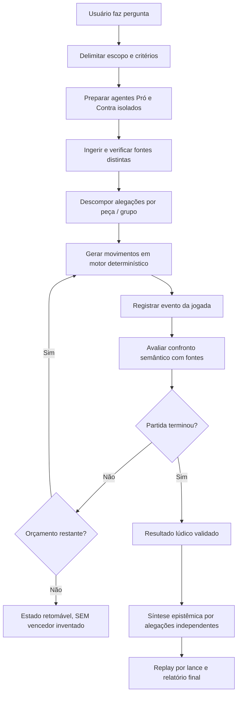

# Gambit Lab Nocturne — Auditoria e plano de reengenharia v2.3

**Base auditada:** ZIP `Gambit_Lab_v2.2_Nocturne_Research_Match.zip` (76 entradas, íntegro), captura de tela do usuário e dois relatórios da investigação “Capitalismo é melhor que o Comunismo”. **Status:** diagnóstico do código e revisão de produto; **não** é validação completa da aplicação em navegador ou chamada Gemini real. O código original do ZIP não foi alterado.

## 1. Objetivo e decisão arquitetural

O MVP deve ser uma ferramenta de **investigação por movimentos**. O protagonista da tela é o tabuleiro e o registro do **lance selecionado**; fontes, agentes, auditoria e métricas ficam em painéis progressivos. O resultado de uma partida é calculado somente pelas regras do jogo, enquanto a qualidade das alegações é avaliada separadamente a partir das evidências. As conclusões precisam ser proporcionais às fontes, sem transformar conformidade de texto em prova de verdade.

Manter FastAPI, `python-chess`, Go 9×9, WebGL, cofre por lado, Event Store, replay e integração Gemini. **Reengenharia cirúrgica** em arbitragem, captura, agregação epistêmica, contratos da linha do tempo e frontend.

### Classificação dos achados

| ID | Gravidade | Verificação | Achado no ZIP | Ação obrigatória |
|---|---|---|---|---|
| C01 | **Bloqueante científico** | Confirmado no código | `preparation.py` e `recording.py` classificam `SUPPORTED` ao encontrar a citação literalmente, sem checar se ela justifica a alegação | Separar `QUOTE_FOUND`/`SOURCE_VERIFIED` de `SUPPORTS_CLAIM`; julgamento semântico com evidência e contraprova explícitas, abstendo-se se incerto |
| C02 | **Bloqueante científico** | Confirmado no código | `play.py` rotula uma peça como “Neutralizada” e registra `REFUTED` ao ser capturada fisicamente, sem prova de refutação semântica | Captura física `PIECE_CAPTURED` ≠ refutação factual. Fazer avaliação adversarial independente e registrar `NOT_ASSESSED` quando não há evidências suficientes |
| C03 | **Bloqueante científico** | Confirmado no código | `conclusion.py` multiplica confiança por pesos de peça e soma vários votos de uma mesma fonte/tese; isso pode fabricar “superioridade epistêmica” | Unidade de comparação: **alegação independente**, com suporte e conflito de fontes deduplicados; rei/dama/peão não aumentam verdade |
| C04 | **Alto — jogo** | Confirmado no código | `play.py` finaliza por resignação **automática** após déficit ≥800 cp por 3 turnos próprios; screenshot exibe “Pretas vencem por resignação”, não xeque-mate | Desativar resignação automática no padrão ou marcá-la como política explícita da variante; permitir vitória por mate e empates FIDE corretos; verificar estado formal com `board.outcome` |
| C05 | **Alto — variante** | Confirmado no código | `_gate_chess_move` rejeita certas capturas por confiança, mas se todas as jogadas forem bloqueadas retorna a primeira mesmo assim; exceção para mate | Preferência: todas as capturas legais permanecem legais e a disputa epistêmica segue **paralela**. Se escolher variante com bloqueio, definir completamente impasse, check, promoções, legalidade e testes |
| C06 | **Alto — UX** | Confirmado no HTML | Tabuleiro 2D e WebGL não desenham índices visíveis fora do tabuleiro; 2D guarda coordenada apenas em `title`/aria-label | Mostrar `a…h` e `1…8` fora da borda nos dois modos; Go `A B C D E F G H J` / `1…9`, nunca `I` |
| C07 | **Alto — UX** | Confirmado no HTML | Tela prioriza quatro cartões de métricas, conclusão alta, cinco abas e até 32 dossiês; o lance ativo não conduz a hierarquia | Layout centrado no último lance ou cursor de replay; painel contextual único e detalhes sob demanda |
| C08 | **Médio — UX** | Confirmado no HTML | `topbar-pills` mantém status de Gemini/Web/mode sempre visíveis; barra lateral fixa de 64px sem recolhimento | Topbar limpa, status em menu de diagnóstico; toasts somente em **transições** reais e erros; sidebar recolhível |
| C09 | **Alto — precisão** | Confirmado em código e relatórios | Várias peças reutilizam a mesma alegação e mesmo trecho; scores `.82/.85/.88` derivam principalmente da existência de trecho e bônus de classe | Remover `confidence_score` como probabilidade de verdade; usar estados `UNVERIFIED`, `SOURCE_VERIFIED`, `EVIDENCE_REVIEWED`, `SUPPORTED`, `REFUTED`, `INCONCLUSIVE` com justificativa por claim |
| C10 | **Médio — consistência** | Encontrado nos arquivos enviados | Relatório anexo traz “Status COMPLETED / Lances 50 / Resultado de Jogo: Em andamento” enquanto outra tela mostra vitória por resignação | Conferir se é **a mesma sessão e versão**. Garantir `board_result`, `ludic_result` e status derivados de um único evento terminal; não corrigir por suposição |
| C11 | **Médio — rastreabilidade** | Confirmado no código | Linha do tempo guarda `move`, `san`, `piece_id` e 1 citação, mas falta um evento de **confrontação semântica** auditável que faça a ligação explicativa entre ataque e defesa | Em cada captura registrar claim do atacante, claim do defensor, fontes, avaliação e resultado separadamente da captura física |
| C12 | **Alto — privacidade** | Revisar na API | `get_pieces_for_viewer` retorna dados completos quando `viewer_side` não é informado. Sem autenticação do observador no endpoint, o parâmetro pode ser indevidamente usado | Modelo explícito de papéis: *owner*, *white*, *black*, *observer*, e revelar apenas documentos permitidos até abertura/replay. Cobertura de API obrigatória |

## 2. Principais evidências específicas da partida “Capitalismo x Comunismo”

- Uma definição de capitalismo (“baseado na propriedade privada”) foi usada para sustentar afirmações bem mais fortes sobre **inovação**, **eficiência** e **superioridade de preços**; o salto não é demonstrado pelo trecho, embora a interface marque `SUPPORTED`.
- Uma simples ficha bibliográfica do OpenAlex (“Artigo acadêmico indexado ... citações registradas: 0”) foi usada para sustentar uma tese sobre **resiliência histórica de formas de capitalismo** — isso **não** constitui prova da conclusão.
- A mesma referência aparece repetidamente em diferentes peões e lances; contá-la várias vezes como fonte independente distorce o resultado.
- A vitória apresentada é por **resignação material programada**, não por xeque-mate. Isso pode ser uma condição lúdica válida se declarada como decisão do agente, mas não deve ser vendida como “a verdade venceu no tabuleiro”.
- A tese central “capitalismo é melhor que comunismo” está subespecificada: melhor em **qual critério** (produtividade, desigualdade, liberdades, sustentabilidade, inovação, saúde, período)? A investigação precisa decompor o tema, comparar sistemas econômicos com critérios claros e admitir pluralidade e incerteza.

## 3. Contrato de tela — UI Nocturne Focus

### 3.1 Home
- Campo de pergunta central, modo, jogo, política de fontes e botão Iniciar. Opcional: “Como medir melhor?” como assistente para delimitar perguntas normativas e políticas.
- Depois da pergunta, abrir investigação. A pergunta permanece editável em botão discreto.

### 3.2 Workspace — acima da dobra

```text
┌─ GAMBIT LAB / NOCTURNE ──────────────────────────── [☷ menu] ─┐
│  Capitalismo x Comunismo       Debate · Xadrez   [⋯ opções]    │
│  Etapa: replay 40/50  |  Resultado: Pretas por resignação     │
├────────────────────────────────┬───────────────────────────────┤
│  TABULEIRO 3D / 2D             │ LANCE SELECIONADO — 40/50     │
│    8  a8  …  h8                │  20...Nxd3  Cavalo preto      │
│    7  …                         │  Antes: tese X (fonte A)      │
│    ⋮      peças                 │  Contestação: tese Y (B)      │
│    1  a1 …   h1                │  Fonte + trecho + pertinência │
│       a b c d e f g h          │  Capture física: SIM         │
│  [◀] [▶] [reproduzir] [50/50] │  Refutação factual: PENDENTE  │
├────────────────────────────────┴───────────────────────────────┤
│  CONCLUSÃO RESUMIDA: quem ganhou o jogo + conclusão da       │
│  investigação (separadas). [Abrir relatório completo]        │
└────────────────────────────────────────────────────────────────┘
```

- Remover do topo permanente os quatro cartões de telemetria; mostrar métricas detalhadas em **Diagnóstico** ou drawer lateral.
- Quando o usuário selecionar casa, peça, captura ou item de timeline, **todos os painéis sincronizam pelo `ply` e `piece_id`**. Sem informações gerais deslocadas do movimento.
- A aba inicial à direita deve ser `Lance`, com seções recolhíveis `Prova`, `Contestação`, `Parecer`, `Arquivo original`. Outras abas avançadas (`Todos os dossiês`, `Fonte`, `Auditoria completa`, `Event Store`) entram no menu “Detalhes”.
- Não exibir 32 cards simultâneos; virtualizar e abrir apenas a peça selecionada. Dossiês não jogados continuam privados conforme papéis.

### 3.3 Coordenadas e notação
- Xadrez: orientação padrão, brancas embaixo; ranks `8..1` à esquerda e files `a..h` abaixo, fora da borda. Manter valores legíveis ao orbitar 3D, por projeção de rótulos HTML sincronizada à matriz de câmera ou uma moldura ancorada; não girar rótulos até ilegibilidade. Nome do lance `SAN` gerado por `python-chess` e par origem/destino via `UCI`, por exemplo `20...Nxd3 (f4→d3)`. Número completo e lado devem derivar do estado, não de índices inventados.
- Go 9×9: colunas `A B C D E F G H J`, linhas `1..9`; indicar `B D4`/`W E5`, passes, capturas, ko e pontuação, conforme o motor.
- Botão `Girar tabuleiro` opcional, rótulos sempre recalculados segundo a orientação.
- Clique na peça mostra coordenada e tese *daquela peça naquele lance*, não necessariamente seu dossiê atual quando assistindo ao replay histórico.

### 3.4 Navbar, sidebar e status
- Navbar: **Gambit Lab** + título curto da sessão + ações ⋯. Remover badges permanentes de Gemini e Web e o rótulo redundante Debate · Xadrez caso já esteja no cabeçalho.
- Menu “Estado & diagnóstico” sempre acessível por botão de ícone, com modo ativo, busca, modelo, última latência, tokens, custo, status da sessão e incidentes; não ocultar falha crítica.
- Toast só na mudança real: `Conectado`, `Pesquisa Web ativa`, `Sem conexão`, `API excedeu cota`, `Fonte indisponível`, `Etapa concluída`; usar debounce e nunca anunciar “sucesso” por polling repetido.
- Sidebar colapsável (desktop 56px → 0 com botão de menu; ou 56px → 220px em modo expandido), responsiva como drawer em mobile, ESC fecha, preferências persistidas localmente e foco de teclado preservado.
- Tema profundamente escuro (`#050506` plano, cartões `#0c0d10`, borda `#23232b`, texto `#e9e9ed`, acento discreto violeta ou menta). Estrelas em baixa densidade e com movimento sutil; respeitar `prefers-reduced-motion`.

## 4. Regra de jogo e encerramento — corrigir antes de polir

### 4.1 Xadrez
1. `python-chess` é fonte única para posições, lances legais, xeque, xeque-mate e empates.
2. O jogador/engine escolhe movimentos legais; **a avaliação epistêmica não retira uma captura legal do Xadrez padrão**. Se for escolhida uma variante com captura condicionada, ela deve ser ativada explicitamente e totalmente especificada/testada — nunca apresentada como FIDE.
3. Condições terminais: xeque-mate, afogamento, material insuficiente, repetição, 50/75 lances, resignação **explicitamente atribuída à política do agente** ou acordo. Não prometer que haverá vencedor: empates são válidos.
4. **Desabilitar resignação material automática por padrão**. Se houver, permitir desligar e registrar: `agent_resignation`, algoritmo, parâmetro e evidências lúdicas. A regra de déficit não constitui xeque-mate nem refutação da tese.
5. Não prolongar artificialmente uma partida já terminada apenas para gerar mais lances. Limites de tokens e orçamento devem terminar em `BUDGET_EXHAUSTED`, **sem vencedor forçado**.
6. Replay deve comparar cada FEN com aplicação da sequência UCI e com `board.outcome` no final. Exportar PGN e resultado oficial `1-0`, `0-1`, `1/2-1/2`, `*`.

### 4.2 Go
1. Motor controla alternância, movimento legal, capturas por liberdades, ko/superko, suicídio, pontuação e dois passes.
2. Captura de pedras é territorial; a alegação vinculada à pedra **não** se torna automaticamente refutada.
3. Mostrar numeração da jogada, coordenada e contagem de captura no lance.
4. Exportar SGF e teste de reconstrução exata sem LLM.

## 5. Três níveis de verificação — NÃO misturar

| Nível | Significado | Critério |
|---|---|---|
| `INTEGRITY_VERIFIED` | Hashes/eventos correspondem aos dados persistidos | Cadeia íntegra; não prova que o conteúdo está certo |
| `SOURCE_VERIFIED` | URL/documento localizado; **o trecho realmente aparece** | URL/arquivo, hash, offset ou página e citação não vazia |
| `SUPPORTED`/`REFUTED`/`INSUFFICIENT`/`INCONCLUSIVE` | Relação semântica **entre alegação e trecho**, no contexto definido | Julgamento por claim com justificativa, fonte pertinente, checagem de escopo e contraprova |

- Exemplo: a fonte diz “capitalismo é baseado em propriedade privada”; isso pode sustentar uma **definição**, mas não “capitalismo é universalmente mais eficiente”.
- **Rejeitar fallback de citação automática**: selecionar a primeira frase de qualquer artigo e marcar suporte é inaceitável. No máximo, indicar “Fonte anexada; relevância ainda não avaliada”.
- **`confidence_score = 0.88` não é 88% de certeza** sem calibração. Usar `heuristic_priority` com rótulo claro, ou ocultar o percentual até avaliação válida.
- Deduplicar alegações semanticamente iguais e fontes por DOI/URL/hash; identificar suporte independente, não contar 8 peões como 8 provas.
- Conteúdo encontrado não garante veracidade da fonte. Exibir a razão de aceitação, escopo, evidência contrária e grau de incerteza de forma legível e sem falso senso de precisão.

## 6. Especificação de evento de lance (backend → UI)

```json
{
  "session_id": "sess_id",
  "ply": 40,
  "game": "chess",
  "move": { "uci": "f4d3", "san": "Nxd3", "from": "f4", "to": "d3", "color": "black", "kind": "capture" },
  "piece": { "id": "black_knight_g8", "role": "contraponto", "claim_id": "claim_X" },
  "opponent": { "piece_id": "white_pawn_d2", "claim_id": "claim_Y" },
  "evidence": { "attacker_artifact_ids": ["a"], "defender_artifact_ids": ["b"], "quotes": [], "source_status": "SOURCE_VERIFIED" },
  "argument_verdict": { "status": "INCONCLUSIVE", "reason": "Não foi apresentada refutação semântica decisiva", "reviewer": "agent", "evaluated_at": null },
  "board_outcome": { "physical_capture": true, "check": false, "mate": false, "fen_after": "<FEN real>" },
  "event_seq": 120,
  "event_hash": "<hash real>"
}
```

*Valores acima são **ilustrativos** e devem ser produzidos pelo backend, nunca hardcoded no frontend.*

Regras: `claim_id` e `artifact_id` devem existir, o trecho citado deve casar com o hash do arquivo, o lance deve ser legal, o `board.fen()` depois do lance deve casar com o snapshot, e `argument_verdict` não pode ser inferido de `is_capture`. Salvar `actor`, `timestamp`, `prompt/model version` quando LLM foi realmente chamado e `token_usage` real.

## 7. Novo fluxo do produto



No Go, o mesmo fluxo corresponde a jogadas territoriais e análises por regiões. FUSION junta **evidências e resumos**, não posições dos tabuleiros.

## 8. Prioridades de implementação

**P0 — Correção científica e de regras, antes de qualquer estética:**
1. Testar e corrigir `SOURCE_VERIFIED` vs `SUPPORTED` (`preparation.py`, `recording.py`, `conclusion.py`).
2. Separar captura física de `REFUTED`; tratar o gate inconsistente (`play.py`).
3. Auditar `board.outcome`/resignação e deixar encerramento formal explícito (`play.py`, `chess_engine.py`, `conclusion.py`).
4. Desduplicar fontes/claims e não ponderar verdade por tipo de peça (`conclusion.py`).
5. Corrigir fidelidade dos dossiês no replay (snapshot por lance) e isolamento de API (`orchestrator.py`, `match.py`).

**P1 — UX centrada no tabuleiro:**
6. Incluir rótulos externos 3D/2D Xadrez/Go e notação SAN/UCI; sincronizar seleção do lance.
7. Redesenhar layout do workspace com painel contextual por lance, mover 32 dossiês para drawer, compactar conclusão.
8. Navbar minimalista, status por toast em transições e sidebar recolhível.

**P2 — Validação e publicação:**
9. Testes end-to-end em Chromium reais, desktop e mobile, temas, 3D/2D, ações do tabuleiro e perfis de acesso.
10. Testar contra fatos verificáveis, documentos adversariais, múltiplas fontes independentes e citações irrelevantes.
11. Executar no ambiente Windows do projeto a suíte completa de regressão + partida longa, export PGN/SGF e relatórios.
12. Publicar após evidência de aprovação da matriz; não apagar trabalho anterior e não imprimir chaves de API.

## 9. Matriz de aceite (deve virar teste automatizado)

| ID | Cenário | Critério obrigatório |
|---|---|---|
| UX01 | Iniciar debate e abrir workspace desktop/mobile | Tabuleiro e painel **Lance atual** dominam viewport; sem cartões redundantes acima da dobra |
| UX02 | Xadrez 3D e 2D | Coordenadas a–h e 1–8 externas e legíveis, brancas embaixo, mesmas posições do FEN |
| UX03 | Go 9×9 | Coordenadas A B C D E F G H J e 1–9 corretas nos dois modos |
| UX04 | Selecionar lance 40 `Nxd3` | Painel mostra lado, origem/destino, peça, captura, citações e se houve refutação factual realmente avaliada |
| UX05 | Avançar/voltar replay | Posição, tese e evidências mudam para o **snapshot histórico**, sem chamar Gemini |
| UX06 | Sidebar recolher/abrir | Painel principal aproveita espaço, teclado/ESC funcionam, mobile sem overflow |
| UX07 | Status conectou/desconectou | Toast de transição uma vez, falha acessível via Diagnóstico; topbar sem badges persistentes |
| EP01 | Documento prova definição, mas não superioridade | SOURCE_VERIFIED, **não SUPPORTED** para a tese mais forte |
| EP02 | Dois peões usam mesmo DOI/trecho | Uma fonte independente e uma mesma alegação na síntese (não dois votos) |
| EP03 | Captura legal sem refutação | `PIECE_CAPTURED`, `argument_verdict=INCONCLUSIVE/NOT_ASSESSED`, **nunca** `REFUTED` automático |
| EP04 | Captura legal é única fuga do xeque | Permanece legal no modo FIDE; não selecionar lance proibido ou deixar tabuleiro em xeque |
| CH01 | Sequência arbitral de mate | FEN final em mate e placar correto sem resignação automática |
| CH02 | Afogamento/material insuficiente/repetição | Empates reconhecidos e ninguém forçado a vencer |
| CH03 | Fim por orçamento | `BUDGET_EXHAUSTED` + botão retomar; sem vencedor inventado |
| CH04 | Resignação explícita (opcional) | Evento, lado que resigna, placar correto e política exibida; não rotular xeque-mate |
| GO01 | Go dois passes | Pontuação por área + komi e replay SGF corretos |
| SEC01 | Lado A solicita documentos privados B | Negado na API independentemente de `viewer_side` fornecido pelo cliente |
| RPT01 | Mesmo replay em 3D, 2D, JSON, PGN/SGF e relatório | Total de lances, peças, hashes e resultado consistentes |
| SCI01 | Pergunta normativa polarizada | Exigir critérios e oferecer síntese qualificada; vencedor do jogo não decide “verdade” |

## 10. Como validar sem alegações não comprovadas

- Executar localmente `python -m compileall -q services packages` e `python -m pytest tests -q` em ambiente com todas as dependências instaladas.
- Conferir `python-chess` em vez de supor disponibilidade; rodar testes separados da API Gemini real.
- Testar 1 caso PRO/CONTRA com artefatos semânticos contraditórios, 1 caso com fonte irrelevante, 1 caso com citações inventadas, 1 partida de mate conhecida, 1 empate FIDE e 1 partida Go completa.
- Guardar print e log de execução real; não declarar “100% correto” por apenas contagem de testes.

**Status desta auditoria:** ZIP íntegro, 42 arquivos Python passaram na análise sintática e JavaScript inline passou em `node --check`; testes de runtime não foram concluídos neste ambiente por falta do módulo `chess` (python-chess). `SUPPORTED` indevido, captura→`REFUTED` e score por peça foram confirmados por inspeção de código. Nenhum arquivo do ZIP enviado foi modificado.
