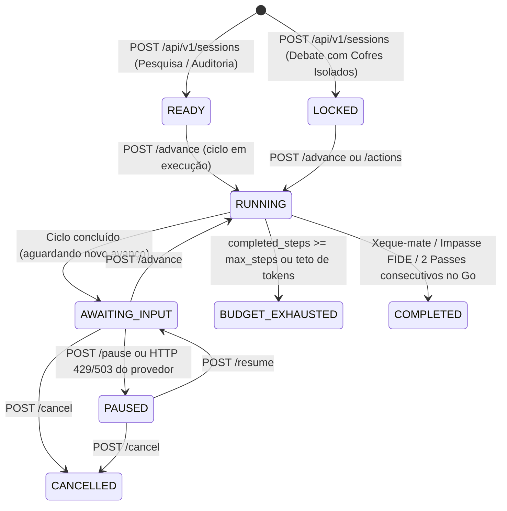

# Plano de Migração Controlada — Gambit Lab 2.0 → Gambit Lab Nocturne (R1.0)

## 1. Estratégia de Migração sem Reescrita Destrutiva

A migração do **Gambit Lab 2.0 (`v2.0-cosmic`)** para o **Gambit Lab Nocturne (`v2.1.0-nocturne`)** seguiu o modelo de **evolução aditiva e retrocompatível** no branch `refactor/nocturne-audit`:

1. **Componentes Preservados Intactos**:
   - Motores determinísticos `EpistemicChessEngine` (`packages/game_rules/chess_engine.py`, baseado em `python-chess`) e `GoEngine9x9` (`packages/game_rules/go_engine.py`).
   - Registro imutável de eventos encadeados por hash SHA-256 (`services/api/storage/event_store.py`).
   - Cofre de documentos com isolamento de Debate (`HTTP 403`) (`services/api/storage/vault.py`).
   - Pipeline de conciliação e deduplicação SHA-256 multi-estratégia (`services/api/fusion/pipeline.py`).
   - Malhas procedurais WebGL 3D de peças de Xadrez e pedras lenticulares de Go + tabuleiro 2D Acessível WCAG (`apps/web/index.html`).

2. **Componentes Reengenheirados**:
   - **Descoberta de Capacidades (`GET /api/v1/capabilities`)**: O cliente descobre dinamicamente se o Gemini e a Pesquisa Web estão configurados e habilitados.
   - **Adaptador de Pesquisa Web Opt-In (`WebSearchAdapter`)**: Políticas formais `OWN_ONLY`, `WEB_ONLY` e `HYBRID` com anti-SSRF estrito.
   - **Orquestrador de Turnos Contínuos (`POST /api/v1/sessions/{id}/advance`)**: Elimina o limite artificial de 3 lances, separando progressão real (`CONTINUE_INVESTIGATION`) de replay histórico (`GET /api/v1/sessions/{id}/replay?up_to_seq=...`).
   - **Máquina de Estados e Controle Operacional**: Rotas `/pause`, `/resume`, `/cancel`, idempotência (`Idempotency-Key`) e controle de concorrência otimista (`expected_version` → `409 Conflict`).
   - **Honestidade de Modos e Telemetria**: `DEMO_OFFLINE`, `LIVE_DOCUMENTS`, `LIVE_WEB` e `LIVE_HYBRID`, extração real de `usageMetadata` e bloqueio de fallback silencioso em erros `429`/`503`.

---

## 2. Máquina de Estados da Sessão



---

## 3. Matriz de Retrocompatibilidade de Contratos REST

| Contrato / Campo | Versão Anterior (`v2.0`) | Versão Nocturne (`v2.1.0-nocturne`) | Compatibilidade |
| :--- | :--- | :--- | :--- |
| `source_policy` | `"own_only"` \| `"web_opt_in"` | `"OWN_ONLY"` \| `"WEB_ONLY"` \| `"HYBRID"` | **100% Retrocompatível** via `normalize_source_policy()` (`own_only` → `OWN_ONLY`; `web_opt_in` → `HYBRID`). |
| `POST /sessions/{id}/actions` | Submissão manual de lance/claim | Mantido intacto + novo `POST /sessions/{id}/advance` | **100% Retrocompatível** (todos os 41 testes legados passam sem alteração). |
| `GET /sessions/{id}/replay` | Replay completo até o fim | Aceita `?up_to_seq=N` opcional (default: replay integral) | **100% Retrocompatível**. |
| `SessionDetailResponse` | Campos base + `verification_tiers` | Adiciona `execution_mode`, `ply_count`, `investigation_step_index`, `max_steps`, `provider_usage` | **Aditivo** (nenhum campo existente removido). |

---

## 4. Variáveis de Ambiente e Configuração

Consulte `.env.example` na raiz do projeto:

| Variável | Valor Padrão | Descrição |
| :--- | :--- | :--- |
| `GEMINI_API_KEY` | *(vazio)* | Chave da API Google Gemini (mantida exclusivamente no backend; jamais exposta ao cliente). Se ausente, o servidor opera em `DEMO_OFFLINE` rotulado. |
| `GEMINI_MODEL` | `gemini-flash-lite-latest` | Modelo Gemini utilizado nas chamadas `LIVE_*`. |
| `GAMBIT_FORCE_DEMO` | `0` | Quando `1`, força modo `DEMO_OFFLINE` mesmo com chave presente (usado em suítes unitárias/integração determinísticas). |
| `GAMBIT_WEB_SEARCH_ENABLED` | `1` | Habilita (`1`) ou desabilita (`0`) o `WebSearchAdapter` para políticas `WEB_ONLY` e `HYBRID`. |
| `SOURCE_POLICY_DEFAULT` | `OWN_ONLY` | Política padrão de fontes (zero chamadas externas por padrão sem opt-in do usuário). |

---

## 5. Procedimento de Deploy Local e Rollback

### Execução / Upgrade
```powershell
git checkout refactor/nocturne-audit
.\.venv\Scripts\python.exe -m pytest tests/ -v
.\.venv\Scripts\python.exe -m uvicorn services.api.main:app --host 127.0.0.1 --port 8000
```

### Rollback Seguro
Como nenhuma estrutura persistente anterior foi corrompida e todos os contratos são aditivos:
1. Para desativar apenas a Pesquisa Web mantendo o restante da release Nocturne: defina `GAMBIT_WEB_SEARCH_ENABLED=0` no `.env`.
2. Para operar 100% offline sem consumo de API externa: defina `GAMBIT_FORCE_DEMO=1` no `.env`.
3. Para reverter integralmente ao baseline anterior: `git checkout master` (`21425e0`).

