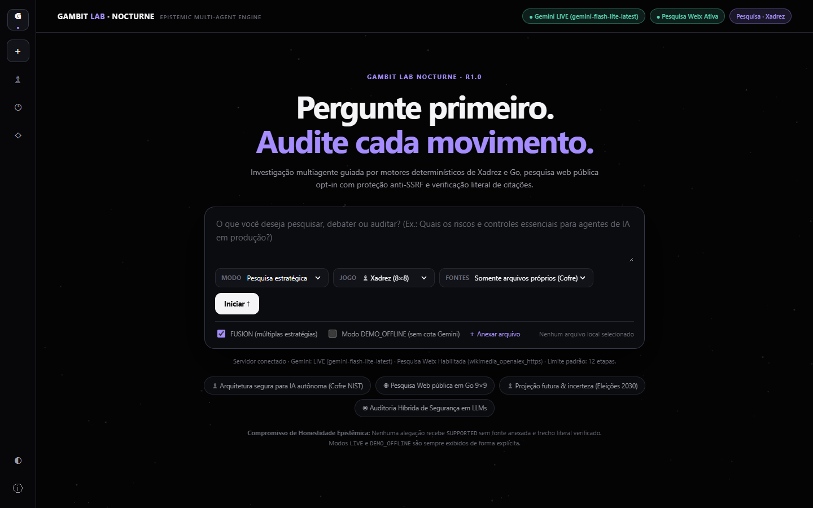
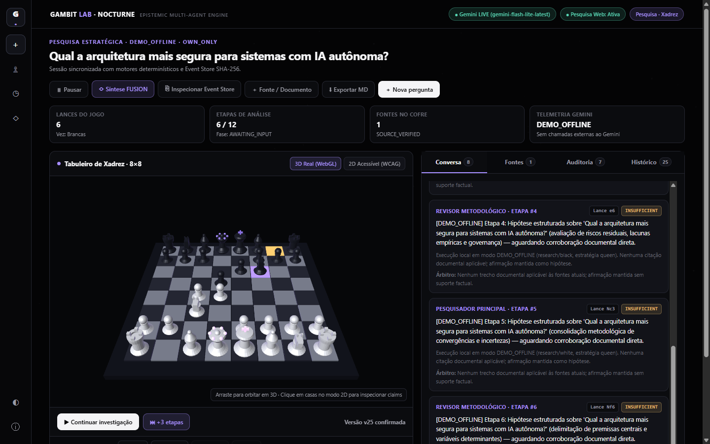
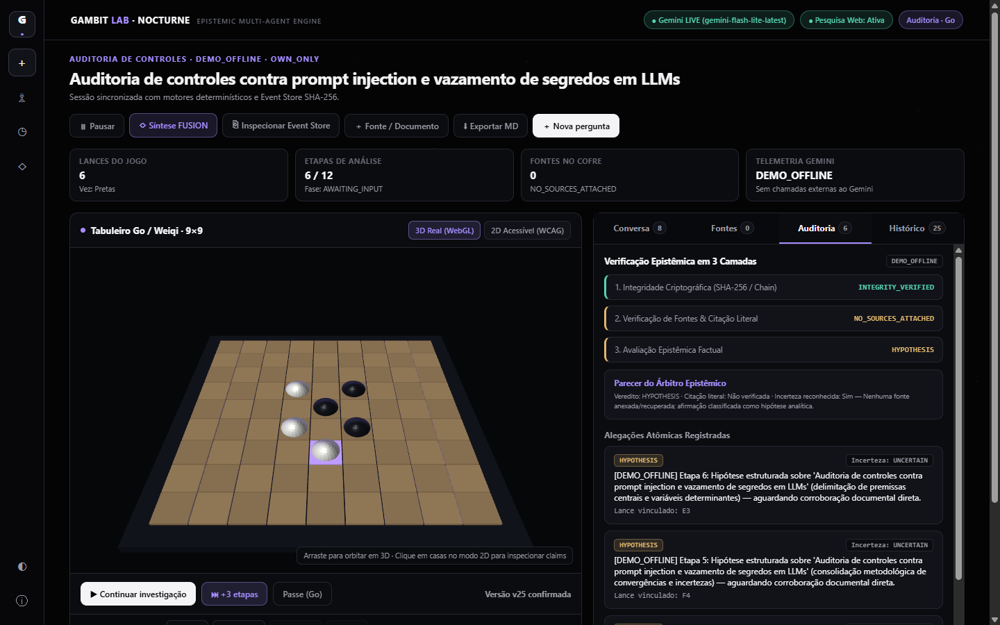

# Gambit Lab Nocturne (R1.0 / v2.1) — Framework Multiagente Orientado por Jogos

> **Princípio Central**: *O LLM propõe, as regras do jogo restringem, as evidências sustentam e o sistema registra.*

O **Gambit Lab Nocturne** é um framework de raciocínio, debate e auditoria multiagente guiado por motores formais de jogos (*Game-Driven Multi-Agent Epistemic System*). A plataforma estrutura investigações auditáveis em sequências procedurais rigorosas:

$$\text{Pergunta} \longrightarrow \text{Hipótese} \longrightarrow \text{Busca / Cofre} \longrightarrow \text{Citação Literal} \longrightarrow \text{Contestação} \longrightarrow \text{Arbitragem} \longrightarrow \text{Event Store SHA-256}$$

---

## 1. Novidades da Reengenharia Nocturne (`v2.1.0-nocturne`)

- **Descoberta Real de Capacidades (`GET /api/v1/capabilities`)**: Expõe em tempo real a disponibilidade do Google Gemini e da Pesquisa Web pública, políticas ativas e orçamento padrão de etapas.
- **Pesquisa Web Pública Opt-In com Anti-SSRF (`WebSearchAdapter`)**: Políticas explícitas `OWN_ONLY` (zero chamadas externas), `WEB_ONLY` e `HYBRID`, consultando fontes públicas HTTPS (OpenAlex + Wikimedia/Wikipedia + snapshots HTTPS validados) com bloqueio anti-SSRF estrito (`localhost`, RFC 1918, `169.254.169.254`, redirecionamentos e esquemas não-HTTPS) e registro `SHA-256`.
- **Progressão Contínua sem Limite Artificial de 3 Lances (`POST /api/v1/sessions/{id}/advance`)**: Investigações avançam continuamente por 10+ lances legais em Xadrez 8×8 e Go 9×9 (padrão 12 etapas, configurável até 60), com `Idempotency-Key`, concorrência otimista (`expected_version` → `409 Conflict`) e controles `/pause`, `/resume` e `/cancel`.
- **Separação Semântica entre Avanço e Replay**:
  - **`▶ Continuar investigação`**: Executa novo ciclo real de pesquisa/arbitragem e aplica lance validado pelo motor determinístico.
  - **`Replay histórico` (`GET /api/v1/sessions/{id}/replay?up_to_seq=N`)**: Reconstrói qualquer posição histórica do `EventStore` com **zero chamadas ao LLM**.
- **Honestidade Radical de Execução e Telemetria**:
  - Modos explícitos: `DEMO_OFFLINE`, `LIVE_DOCUMENTS`, `LIVE_WEB` e `LIVE_HYBRID`.
  - Extração real de `usageMetadata` (`prompt_tokens`, `completion_tokens`, `tokens`) e `latency_ms` nas chamadas Gemini; `Não medido` quando offline.
  - Proibição de fallback silencioso `LIVE → DEMO` em erros `HTTP 429` / `503`.
  - Nenhuma alegação recebe `SUPPORTED` sem fonte anexada/recuperada e trecho literal verificado nos bytes do artefato (`DocumentVault.find_verified_quote_offset`).
- **Identidade Visual Gambit Lab Nocturne**: Paleta de alto contraste (`#040405` / `#0B0C0F` / `#A68DFF`), alternância de tema `Nocturne / Cosmic`, WebGL 3D procedural nativo preservado + tabuleiro **2D Acessível (WCAG AA)** e 4 abas analíticas (`Conversa`, `Fontes`, `Auditoria`, `Histórico`).

---

## 2. Capturas Reais Verificadas (Chromium + WebGL)

| Home Conversacional Nocturne | Workspace Xadrez 3D (6+ Lances) | Workspace Go 9×9 + Auditoria 3 Camadas |
| :---: | :---: | :---: |
|  |  |  |

---

## 3. A Matriz 3×2 de Aplicações e Pesquisa FUSION

Modalidade e Jogo são duas dimensões ortogonais e independentes (**ADR-001**):

| Modalidade \ Jogo | Xadrez (8×8 — `python-chess`) | Go / Weiqi (9×9 — `GoEngine9x9`) |
| :--- | :--- | :--- |
| **Pesquisa (`research`)** | Gambitos e linhas estratégicas orientam busca central, contraponto e exploração de hipóteses. | Cobertura temática, expansão por influência e aprofundamento territorial de fontes. |
| **Debate (`debate`)** | Confronto de evidências com **capturas condicionadas** pelo árbitro factual e cofres privados isolados (`HTTP 403`). | Disputa territorial com contestação de teses; pretas iniciam; captura por liberdades e avaliação factual separada. |
| **Auditoria (`audit`)** | Peças representam controles, testes e riscos; confrontos expõem lacunas de conformidade. | Regiões representam requisitos normativos, achados verificados e lacunas (`HYPOTHESIS` / `INSUFFICIENT`). |

### Pesquisa FUSION (`POST /api/v1/sessions/{id}/fusion`)
Combina de 1 a 3 estratégias simultâneas com **isolamento estrito de tabuleiros** (sem misturar estados de jogo incompatíveis) e **deduplicação criptográfica de fontes por `SHA-256`** antes da síntese unificada (`CONVERGENT`, `CONTRADICTORY`, `DIFFERENT_SCOPE`, `INSUFFICIENT`).

---

## 4. Estrutura do Repositório e Entregáveis de Engenharia

```text
Gambit_Lab/
├── apps/
│   └── web/index.html             # UI Gambit Lab Nocturne (WebGL 3D procedural + 2D WCAG AA)
├── services/
│   └── api/
│       ├── agents/
│       │   ├── gemini_adapter.py      # Adaptador Gemini real (usageMetadata, retries 429/503) + DEMO_OFFLINE honesto
│       │   └── web_search_adapter.py  # Busca pública HTTPS (OpenAlex / Wikimedia) + proteção Anti-SSRF
│       ├── fusion/pipeline.py         # Orquestrador FUSION com isolamento de ramos e deduplicação SHA-256
│       ├── models/schemas.py          # Contratos Pydantic v2.1 (Capabilities, Advance, 3 Camadas Epistêmicas)
│       ├── routes/                    # /capabilities, /sessions, /advance, /artifacts, /fusion, /replay, /reports
│       └── storage/                   # SessionManager, EventStore SHA-256 encadeado e DocumentVault
├── packages/
│   └── game_rules/                # EpistemicChessEngine (python-chess) e GoEngine9x9
├── tests/
│   ├── unit/                      # Testes dos motores FIDE/Go, EventStore e FUSION
│   ├── integration/               # Matriz 3x2, segurança, camadas epistêmicas e AT-01..AT-24 Nocturne
│   └── live/                      # Testes ponta a ponta reais com Google Gemini e LIVE_WEB
├── docs/screenshots/              # Capturas Desktop e Mobile verificadas via Chromium CDP
├── AUDIT_REPORT.md                # Relatório técnico completo da auditoria (file:line, causas e correções)
├── MIGRATION_PLAN.md              # Plano de migração controlada e máquina de estados
├── TEST_MATRIX.md                 # Matriz de rastreabilidade dos 66 testes automatizados
└── CHANGELOG.md                   # Histórico detalhado de versões
```

---

## 5. Como Executar Localmente

### Pré-requisitos
- Python 3.12+

### Passo 1: Criar e ativar o ambiente virtual
```powershell
# Windows (PowerShell)
python -m venv .venv
.\.venv\Scripts\Activate.ps1
pip install -r requirements.txt
```

### Passo 2: Configurar variáveis de ambiente
```powershell
Copy-Item .env.example .env
```
- **Modo `DEMO_OFFLINE` (sem chave)**: Funciona imediatamente sem configurar `GEMINI_API_KEY`, rotulando todas as sessões de forma transparente como `DEMO_OFFLINE`.
- **Modos `LIVE_DOCUMENTS` / `LIVE_WEB` / `LIVE_HYBRID`**: Preencha `GEMINI_API_KEY` no arquivo `.env` local (ignorado pelo Git). A chave nunca é enviada ao navegador.

### Passo 3: Iniciar o servidor FastAPI
```powershell
.\.venv\Scripts\python.exe -m uvicorn services.api.main:app --host 127.0.0.1 --port 8000 --reload
```
Acesse:
- **Aplicação Web Nocturne (3D WebGL + 2D WCAG)**: http://127.0.0.1:8000/
- **Capacidades Ativas JSON**: http://127.0.0.1:8000/api/v1/capabilities
- **Documentação OpenAPI / Swagger**: http://127.0.0.1:8000/docs

---

## 6. Executando a Suíte Completa de Testes (66 Testes)

```powershell
# Suíte completa (Unitários + Integração + AT-01..AT-24 + Live Gemini/Web):
.\.venv\Scripts\python.exe -m pytest tests/unit tests/integration tests/live -v
```

Consulte [AUDIT_REPORT.md](AUDIT_REPORT.md) e [TEST_MATRIX.md](TEST_MATRIX.md) para o detalhamento individual dos 66 testes.

---

## 7. Principais Endpoints REST (`v2.1.0-nocturne`)

| Método | Rota | Descrição |
| :--- | :--- | :--- |
| `GET` | `/api/v1/capabilities` | Estado real do Gemini, Pesquisa Web, políticas e limites. |
| `POST` | `/api/v1/sessions` | Cria sessão (`mode`, `game`, `source_policy`, `max_steps`, `force_demo`). |
| `GET` | `/api/v1/sessions/{id}` | Estado completo da sessão, contadores separados, claims, artefatos e eventos. |
| `POST` | `/api/v1/sessions/{id}/advance` | Avança 1..5 etapas reais da investigação (`expected_version`, `Idempotency-Key`). |
| `POST` | `/api/v1/sessions/{id}/pause` | Pausa a sessão em andamento. |
| `POST` | `/api/v1/sessions/{id}/resume` | Retoma uma sessão pausada. |
| `POST` | `/api/v1/sessions/{id}/cancel` | Cancela formalmente a sessão. |
| `POST` | `/api/v1/sessions/{id}/artifacts` | Ingere documento no cofre (`public`, `white` ou `black`) com hash `SHA-256`. |
| `POST` | `/api/v1/sessions/{id}/artifacts/web-snapshot` | Captura snapshot HTTPS público auditável com proteção Anti-SSRF. |
| `GET` | `/api/v1/sessions/{id}/replay` | Replay determinístico integral ou parcial (`?up_to_seq=N`) sem chamadas ao LLM. |
| `POST` | `/api/v1/sessions/{id}/fusion` | Executa Pesquisa FUSION multi-estratégia com deduplicação `SHA-256`. |
| `GET` | `/api/v1/sessions/{id}/reports` | Exporta dossiê fiel da sessão em `json` ou `markdown`. |

---

## 8. Licença
Distribuído sob a licença MIT.
