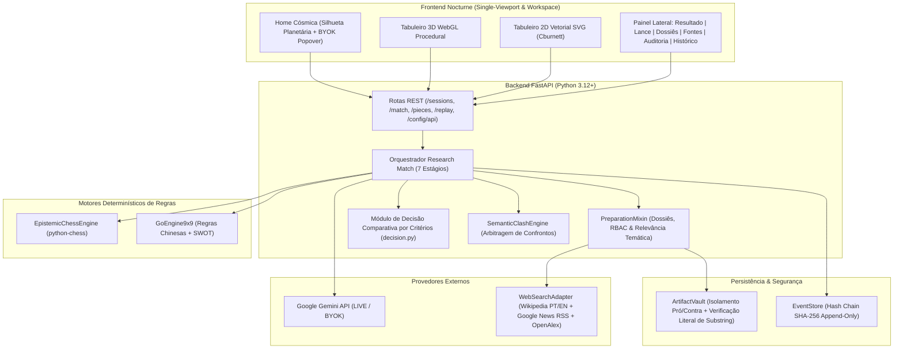
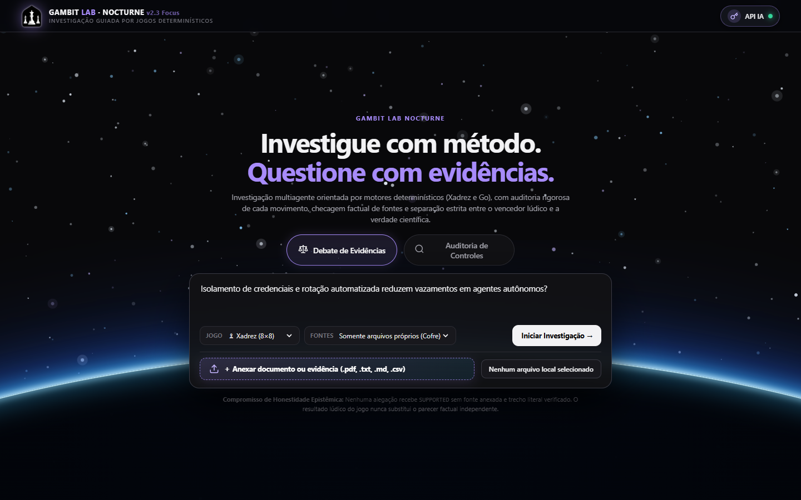
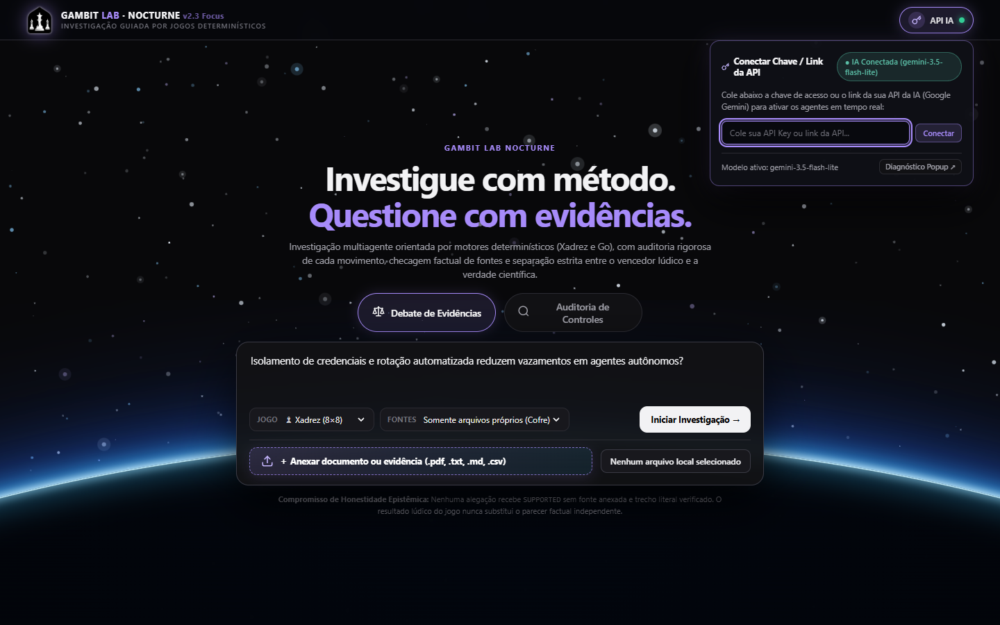
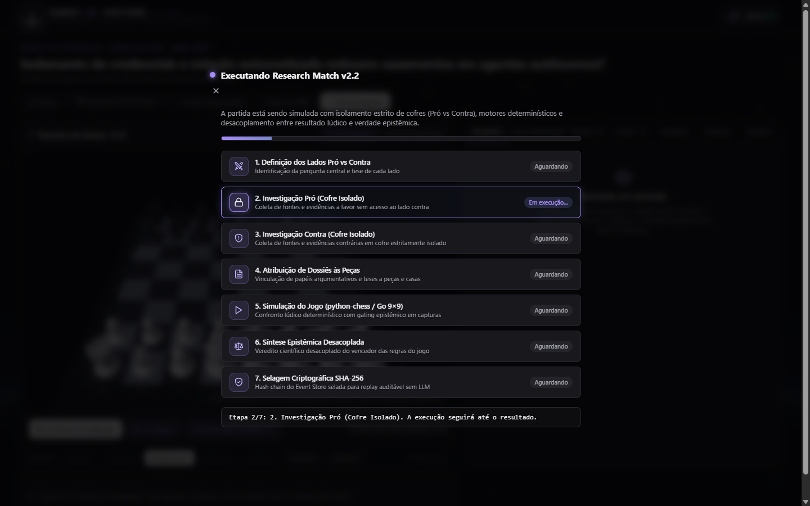
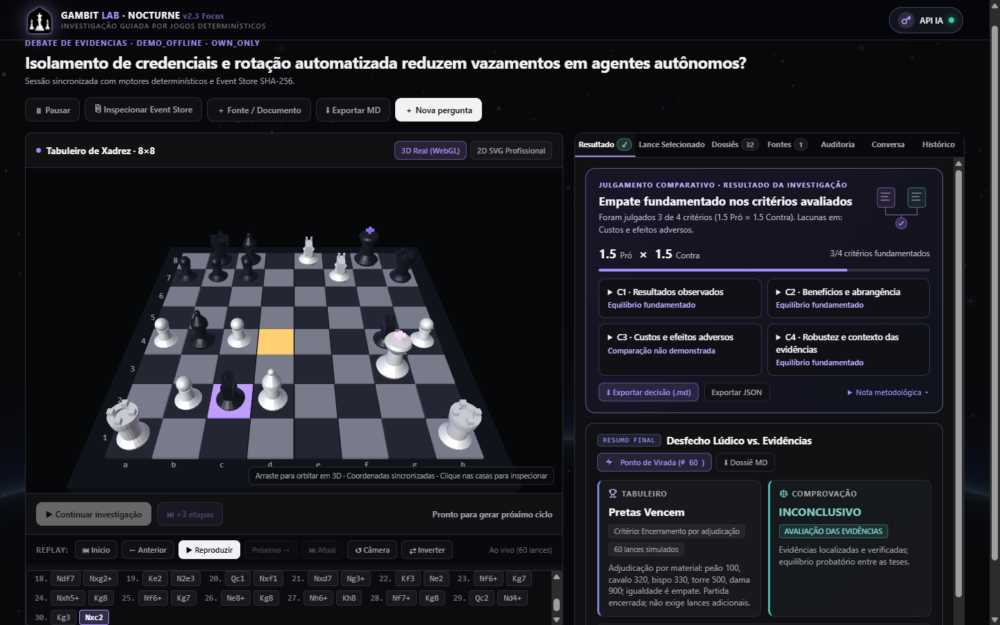
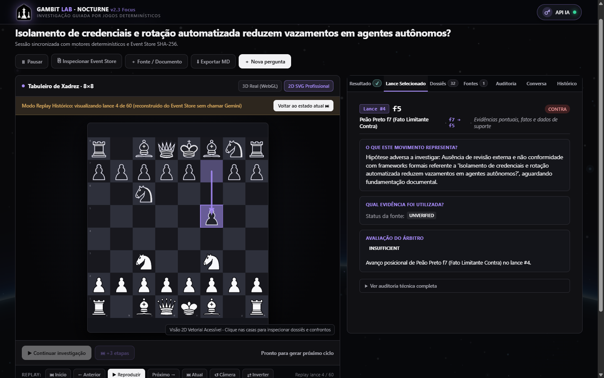
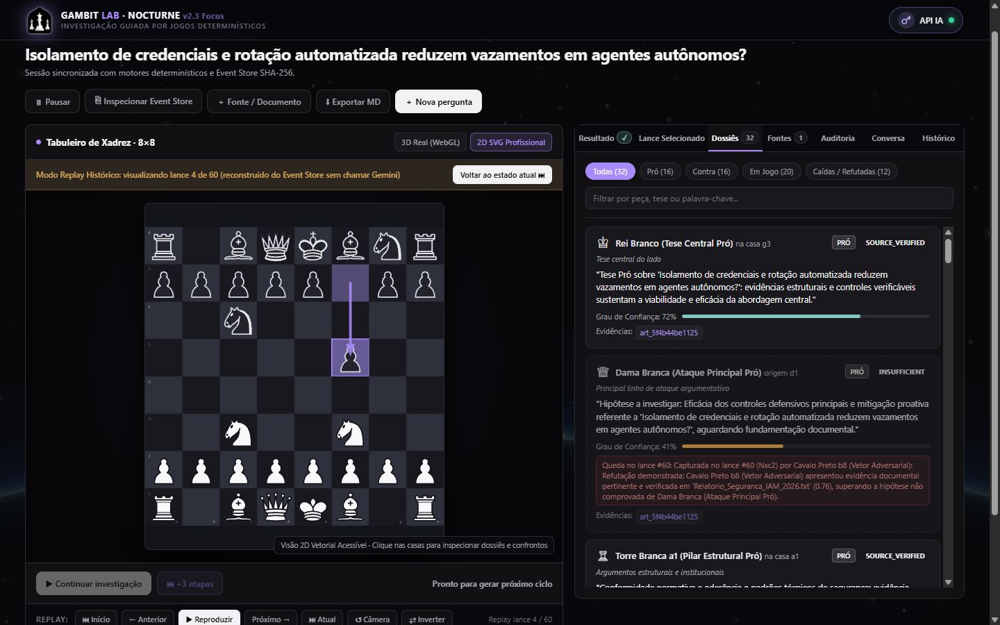

# Gambit Lab Nocturne

**Framework multiagente orientado por jogos determinísticos (Xadrez 8×8 e Go 9×9) para Debates de Evidências e Auditorias de Controles com rastreabilidade criptográfica SHA-256.**

*Game-Driven Multi-Agent Framework for Evidence-Based Debate, Normative Auditing, and Verifiable Reasoning*

---

## Sumário

1. [Visão Geral e Propósito](#1-visão-geral-e-propósito)
2. [Princípio Epistêmico Fundamental](#2-princípio-epistêmico-fundamental)
3. [Modalidades de Investigação](#3-modalidades-de-investigação)
4. [Pipeline Research Match v2 (7 Estágios)](#4-pipeline-research-match-v2-7-estágios)
5. [Arquitetura do Sistema](#5-arquitetura-do-sistema)
6. [Capturas de Tela Atuais (Nocturne UI)](#6-capturas-de-tela-atuais-nocturne-ui)
7. [Autoria, Revisão Humana e Uso de IA na Implementação](#7-autoria-revisão-humana-e-uso-de-ia-na-implementação)
8. [Estado Atual dos Vereditos e Evolução Futura](#8-estado-atual-dos-vereditos-e-evolução-futura)
9. [Tecnologias Utilizadas](#9-tecnologias-utilizadas)
10. [Como Executar Localmente](#10-como-executar-localmente)
11. [Testes Automatizados](#11-testes-automatizados)
12. [Estrutura do Repositório](#12-estrutura-do-repositório)

---

## 1. Visão Geral e Propósito

O **Gambit Lab Nocturne** é uma plataforma de investigação analítica e auditoria onde dois agentes adversariais (**Lado Pró** e **Lado Contra**) confrontam teses, subteses e documentos sobre um tabuleiro determinístico de **Xadrez (8×8)** ou **Go / Weiqi (9×9)** sob a supervisão de um **Árbitro Semântico Independente**.

Em vez de entregar uma resposta única de caixa-preta como um chat comum de LLM, o Gambit Lab decompõe qualquer pergunta ou escopo de auditoria em **unidades táticas rastreáveis**:
- Cada peça do tabuleiro possui seu próprio **Dossiê Argumentativo** (papel funcional, subtese, grau de confiança, permissões de cofre RBAC e trechos literais verificados).
- Os documentos e fontes coletadas ficam armazenados em **Cofres Isolados por Lado (Regra de Ouro)**: o Lado Pró (`white`) não enxerga documentos privados do Lado Contra (`black`) e vice-versa, exceto quando uma peça é confrontada diretamente no tabuleiro.
- Toda a partida e cada verificação de fonte são seladas em uma cadeia de eventos append-only (`Event Store`) com hashes **SHA-256**, permitindo **Replay Histórico Determinístico** sem nenhuma chamada adicional à IA.

---

## 2. Princípio Epistêmico Fundamental

> **"O LLM interpreta; os motores determinísticos restringem; as evidências literais sustentam; o árbitro avalia por critérios; e o Event Store registra."**

No Gambit Lab, **vencer no tabuleiro nunca equivale automaticamente a ter razão científica ou factual**. Por isso, a aba **Resultado** ao lado do tabuleiro apresenta duas camadas estritamente desacopladas:

1. **Julgamento Comparativo por Critérios (`C1..C4` / `C1..C6`)**: avalia cada dimensão do problema com base exclusivamente em citações literais verificadas nos cofres (`Pró × Contra`), apontando de forma transparente onde houve equilíbrio e onde ainda existem lacunas documentais.
2. **Desfecho Lúdico vs. Estado de Comprovação das Alegações**: separa o vencedor das regras formais do jogo (`python-chess` / `GoEngine9x9`) do veredito epistêmico (`PRO_THESIS_SUPPORTED`, `CONTRA_THESIS_SUPPORTED`, `INCONCLUSIVE` ou `OPEN_HYPOTHESIS`).

---

## 3. Modalidades de Investigação

### 3.1. Debate de Evidências (`debate`)
Projetado para investigar perguntas controversas, comparativas, científicas, históricas, econômicas ou estratégicas:
- **Decomposição em 32 Peças (Xadrez) ou 12 Grupos Estratégicos (Go)**:
  - **Rei (`♔/♚`)**: Tese central do lado (protegida pela *Blindagem Invariante do Rei* enquanto houver subteses ativas no tabuleiro).
  - **Dama (`♕/♛`)**: Linha de ataque argumentativo principal / contraprova central.
  - **Torres (`♖/♜`)**: Pilares estruturais, dados institucionais e marcos regulatórios.
  - **Bispos (`♗/♝`)**: Leitura conceitual, recortes metodológicos e análise de contexto.
  - **Cavalos (`♘/♞`)**: Conexões táticas não lineares, casos de borda e vetores adversariais.
  - **Peões (`♙/♟`)**: Evidências pontuais, fatos empíricos e dados de suporte.
- **Busca Web Multi-Fonte Relevante**: combina **Wikipedia (PT/EN)**, **Google News RSS** (cobertura jornalística atualizada) e **OpenAlex** (artigos científicos revisados por pares), com filtragem semântica de âncoras para evitar fontes fora de tópico e proteção estrita **Anti-SSRF**.

### 3.2. Auditoria de Controles (`audit`)
Projetado para inspecionar conformidade técnica, governança e riscos operacionais frente a referenciais como **ISO/IEC 27001, LGPD, SOC 2, NIST CSF, CIS Controls e OWASP**:
- **Lado Pró (Auditor de Controles)**: mapeia salvaguardas implementadas, políticas formais e evidências de execução.
- **Lado Contra (Auditor de Riscos / Red Team)**: identifica lacunas de cobertura, falhas de rotação/acesso, riscos residuais e não conformidades.
- **No modo Go 9×9**: estrutura os achados em uma **Matriz SWOT Epistêmica** (*Forças, Fraquezas, Oportunidades e Ameaças*) vinculada aos grupos de pedras no tabuleiro.

---

## 4. Pipeline Research Match v2 (7 Estágios)

Quando uma investigação completa é iniciada, o orquestrador executa e exibe em tempo real os **7 estágios formais**:

1. **Definição dos Lados Pró vs Contra**: estruturação da pergunta central, teses de cada lado e plano de critérios de comparação.
2. **Investigação Pró (Cofre Isolado)**: coleta e indexação SHA-256 de fontes favoráveis em cofre exclusivo.
3. **Investigação Contra (Cofre Isolado)**: coleta e indexação SHA-256 de contraprovas e limitações em cofre estritamente isolado.
4. **Atribuição de Dossiês às Peças**: vinculação de subteses heterogêneas, citações literais verificadas por offset e permissões RBAC a cada peça.
5. **Simulação do Jogo (`python-chess` / `Go 9×9`)**: confronto determinístico com *gating epistêmico* em capturas e identificação automática do **Ponto de Virada (Turning Point)**.
6. **Síntese Epistêmica Desacoplada**: julgamento comparativo por critérios (`C1..C4`) e veredito factual independente do placar lúdico.
7. **Selagem Criptográfica SHA-256**: fechamento da cadeia de eventos no `Event Store` para replay auditável instantâneo.

---

## 5. Arquitetura do Sistema



---

## 6. Capturas de Tela Atuais (Nocturne UI)

### 6.1. Tela Inicial (Home Nocturne) e Configuração Rápida de Chave API (BYOK)
Tela inicial em *single-viewport* (sem rolagem indesejada), apresentando a **logo autoral criada pelo desenvolvedor**, partículas cósmicas em múltiplas camadas, silhueta atmosférica do planeta e seletor discreto **`API IA`** no canto superior direito:

| Tela Inicial (Nocturne Home) | Popover de Conexão da Chave / Link de API IA |
| :---: | :---: |
|  |  |

### 6.2. Execução dos 7 Estágios e Workspace 3D com Aba `Resultado` ao Lado do Tabuleiro
Durante a execução, os 7 estágios são acompanhados com ícones vetoriais dedicados. Ao concluir, a aba **`Resultado ✓`** é aberta automaticamente **ao lado do tabuleiro de Xadrez**, exibindo o placar resumido por critérios (`C1..C4`), o comparativo *Tabuleiro vs. Comprovação* e mantendo a síntese longa recolhida por padrão:

| Modal de Progresso (7 Estágios) | Tabuleiro 3D WebGL + Aba `Resultado` Resumida ao Lado |
| :---: | :---: |
|  |  |

### 6.3. Tabuleiro 2D SVG Profissional (`Cburnett`), Inspeção de Lance e Dossiês por Peça
Alternância instantânea para o tabuleiro 2D vetorial com peças clássicas *Cburnett* embutidas (sem risco de falha de carregamento), seta indicadora do lance selecionado e dossiês individuais para todas as 32 peças:

| Tabuleiro 2D + Aba `Lance Selecionado` | Tabuleiro 2D + Aba `Dossiês` (32 Peças Auditáveis) |
| :---: | :---: |
|  |  |

---

## 7. Autoria, Revisão Humana e Uso de IA na Implementação

Este projeto foi idealizado, arquitetado e dirigido por seu criador e desenvolvedor responsável (**Lucas**), contando com o auxílio de ferramentas avançadas de Inteligência Artificial como copiloto de engenharia de software durante a implementação:

- **Concepção e Identidade Visual Autoral**: a proposta conceitual do framework (união de motores de Xadrez/Go com auditoria de evidências), as diretrizes de interface e a **logo oficial do projeto** foram criadas pelo desenvolvedor.
- **Auxílio de IA na Implementação e Elementos 3D**: modelos de IA auxiliaram na aceleração da codificação, na construção da geometria procedural **3D WebGL** das peças de Xadrez e pedras de Go, nos efeitos visuais de partículas e iluminação atmosférica em canvas, bem como na estruturação da suíte de testes automatizados.
- **Revisão, Curadoria e Validação pelo Criador**: **todo o código, regras de negócio, fluxos de interface (UX/UI), filtros de relevância de pesquisa e mecanismos de honestidade epistêmica foram inspecionados, testados, corrigidos e aprovados passo a passo pelo desenvolvedor criador do projeto**.

---

## 8. Estado Atual dos Vereditos e Evolução Futura

Por compromisso estrito com a **honestidade epistêmica**, o Gambit Lab nunca inventa citações nem declara uma tese como comprovada (`SUPPORTED`) quando as fontes públicas coletadas não contêm dados comparáveis suficientes ou quando a pergunta trata de eventos futuros ainda não decidíveis factualmente.

- **Por que alguns resultados atuais aparecem como `INCONCLUSIVO` ou `Empate fundamentado`?**
  - Atualmente, quando a pesquisa automática encontra evidências parciais para ambos os lados ou quando algum critério específico (`C1..C4`) carece de dados quantitativos diretos nas fontes abertas consultadas, o árbitro declara honestamente o empate nos critérios comprovados ou marca a comprovação geral como `INCONCLUSIVO` / `HIPÓTESE EM ABERTO`.
- **Meta de Evolução Futura (Cobertura Universal de Perguntas)**:
  - O objetivo contínuo do projeto é expandir os conectores de busca profunda (*deep research*), aprimorar a extração semântica multi-documento e calibrar o julgamento comparativo para que o sistema consiga entregar **um veredito analítico decisivo, completo e profundamente fundamentado para qualquer tipo de pergunta** (seja histórica, científica, técnica, econômica ou prospectiva por cenários), reduzindo ao mínimo os casos inconclusivos.

---

## 9. Tecnologias Utilizadas

| Camada | Tecnologias |
| :--- | :--- |
| **Backend & API** | Python 3.12+, FastAPI, Uvicorn, Pydantic v2, HTTPX |
| **Motores de Jogo** | `python-chess` (Xadrez 8×8 + Variante Epistêmica) e `GoEngine9x9` (Go 9×9 + Matriz SWOT) |
| **Frontend & Gráficos** | HTML5, CSS3 (Nocturne Design System), JavaScript ES6+, WebGL 3D Procedural, SVG Vetorial (Cburnett) |
| **Inteligência Artificial** | Google Gemini API (`gemini-3.5-flash-lite` / `gemini-flash-latest`) com suporte a chave própria na UI (`BYOK`) e fallback determinístico (`DEMO_OFFLINE`) |
| **Pesquisa Web Auditável** | Adaptador Multi-Fonte HTTPS com proteção Anti-SSRF (Wikipedia PT/EN, Google News RSS e OpenAlex) |
| **Integridade & Auditoria** | Cofre de Artefatos com RBAC por peça, verificação literal de citações por offset e `Event Store` encadeado por **SHA-256** |

---

## 10. Como Executar Localmente

### Opção Rápida (Windows — 1 Clique)
Basta executar o script [`iniciar.bat`](iniciar.bat) na raiz do projeto ou rodar no terminal:
```powershell
.\iniciar.bat
```
O script ativa automaticamente o ambiente virtual, inicia o servidor FastAPI em `http://127.0.0.1:8000` e abre o navegador.

### Passo a Passo Manual (Terminal)

1. **Clonar o repositório**:
   ```bash
   git clone https://github.com/Lucas-715/Gambit-Lab.git
   cd Gambit-Lab
   ```

2. **Criar e ativar o ambiente virtual**:
   - **Windows (PowerShell)**:
     ```powershell
     python -m venv .venv
     .\.venv\Scripts\Activate.ps1
     ```
   - **Linux / macOS**:
     ```bash
     python3 -m venv .venv
     source .venv/bin/activate
     ```

3. **Instalar as dependências**:
   ```bash
   pip install -r requirements.txt
   ```

4. **Configurar sua chave de API da IA (Opcional no `.env` ou direto pela Interface)**:
   - Você pode clicar no botão **`API IA`** (ícone de chave no canto superior direito da tela inicial) e colar diretamente sua chave ou link da API Gemini em tempo de execução.
   - Ou, se preferir persistir em arquivo local, copie `.env.example` para `.env` e defina `GEMINI_API_KEY`.

5. **Iniciar o servidor**:
   ```bash
   python -m uvicorn services.api.main:app --host 127.0.0.1 --port 8000
   ```
   Acesse **`http://127.0.0.1:8000`** no navegador.

---

## 11. Testes Automatizados

O projeto conta com **122 testes automatizados** (unitários e de integração) cobrindo motores de Xadrez e Go, isolamento de cofres (RBAC), bloqueio Anti-SSRF, integridade SHA-256 do Event Store, replay sem chamadas ao LLM e julgamento comparativo por critérios.

Para executar toda a suíte oficial:
```powershell
.\.venv\Scripts\python.exe -m pytest tests/ -q
```

---

## 12. Estrutura do Repositório

```text
Gambit-Lab/
├── apps/
│   └── web/
│       ├── pieces/              # 12 arquivos SVG vetoriais (Cburnett) das peças de Xadrez
│       ├── logo.png             # Logo autoral criada pelo desenvolvedor
│       ├── index.html           # Aplicação Nocturne (Home + Tabuleiro 3D/2D + Abas Analíticas)
│       ├── decision-panel.js    # Renderizador conciso do Julgamento Comparativo por Critérios
│       └── decision-panel.css   # Estilos compactos do painel de decisão na aba Resultado
├── docs/
│   ├── adr/                     # Architecture Decision Records (ADRs)
│   ├── screenshots/             # Capturas de tela atuais da interface
│   ├── RESULTADOS_E_RASTREABILIDADE.md
│   ├── REQUIREMENTS.md
│   └── SPECIFICATION.md
├── packages/
│   ├── contracts/               # Contratos e esquemas compartilhados
│   └── game_rules/              # Motores determinísticos (chess_engine.py, go_engine.py)
├── services/
│   └── api/
│       ├── agents/              # GeminiAdapter, WebSearchAdapter (Multi-Fonte) e Verificadores
│       ├── fusion/              # Pipeline de conciliação multi-estratégia
│       ├── match/               # Orquestrador de 7 estágios, dossiês, decisão e conclusão dual
│       ├── models/              # Schemas Pydantic v2
│       ├── routes/              # Endpoints REST FastAPI
│       └── storage/             # SessionManager, ArtifactVault e EventStore SHA-256
├── tests/
│   ├── unit/                    # Testes unitários de motores, segurança e UI
│   └── integration/             # Testes fim a fim da API, Research Match v2 e rastreabilidade
├── iniciar.bat                  # Inicializador rápido para Windows
├── requirements.txt
└── README.md
```

---

## Licença e Direitos Autorais

Projeto idealizado e desenvolvido por **Lucas** para pesquisa aplicada em sistemas multiagentes verificáveis, arquitetura de software. Todos os direitos reservados ao autor.
