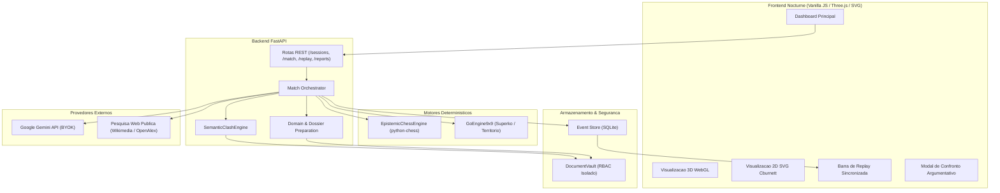

# Gambit Lab

**Game-Driven Multi-Agent Framework for Evidence-Based Debate and Auditing Using LLMs, Chess, Go, and Traceable Reasoning**

[](https://www.python.org/downloads/)
[](https://fastapi.tiangolo.com/)
[-brightgreen.svg)](tests/)
[](#arquitetura-do-sistema)
[](#interface-visual-nocturne)
[](#licenca)

---

## Sumario Executivo

> **Gambit Lab** e um framework experimental de raciocinio multiagente orientado por jogos. Utiliza LLMs, motores deterministicos de Xadrez e Go e mecanismos de verificacao de evidencias para explorar debates e auditorias de forma estruturada e rastreavel.

### Principio Fundamental

$$\text{O LLM interpreta} \longrightarrow \text{As regras do jogo restringem} \longrightarrow \text{As evidencias sustentam} \longrightarrow \text{O arbitro avalia} \longrightarrow \text{O sistema registra}$$

No Gambit Lab, modelos de linguagem nao operam em geracao livre desgovernada. Cada alegacao analitica e vinculada a pecas fisicas de um jogo formal (Xadrez ou Go). O movimento de pecas no tabuleiro e rigorosamente validado por motores deterministas (`python-chess` e `GoEngine9x9`). Confrontos entre argumentos dependem da existencia de evidencias textuais verificadas em cofres privados isolados, sob arbitragem semantica formal e auditoria imutavel registrada em Event Store com hashes SHA-256.

---

## Modalidades do Sistema

O Gambit Lab opera em duas modalidades analiticas principais:

### 1. Debate de Evidencias (`debate`)
- **Objetivo**: Investigar questoes abertas e questoes de fato contrapondo teses favoraveis (Lado Branco / Pro) e contrarias (Lado Preto / Contra).
- **Dossies por Peca**: Todas as 32 pecas do xadrez ou posicoes de Go recebem subtópicos e dimensoes substantivas proprias (ex.: em politica: base partidaria, viabilidade juridica, rejeicao, piso eleitoral; em tecnologia: latencia, seguranca, custos).
- **Cofres Isolados**: As evidencias do Lado Branco sao protegidas contra acesso do Lado Preto via RBAC (HTTP 403 em tentativas de violacao).
- **Confronto Semantico**: Quando uma peca ataca outra, o `SemanticClashEngine` avalia a pertinencia tematica das citacoes. Duas hipoteses nao comprovadas resultam em `CONFRONTO INCONCLUSIVO`, e a peca defensora permanece no tabuleiro.

### 2. Auditoria de Controles (`audit`)
- **Objetivo**: Avaliar sistemas, conformidade e governanca frente a padroes internacionais (ISO 27001, SOC 2, NIST CSF, CIS Controls, LGPD, OWASP).
- **Pecas como Controles**: Cada peca representa um requisito normativo especifico com criterio esperado e achado objetivo.
- **Classificacao de Risco**: Categorizacao automatizada de achados em `CRITICO`, `ALTO`, `MEDIO` e `BAIXO`, com status de conformidade (`CONFORME`, `NAO CONFORME`, `PARCIAL`).

---

## Pilares Tecnicos

### Epistemic Chess & Cofres Individuais por Peca
- Cada peca do xadrez possui um **Cofre de Evidencias Individual** com autorizacao estrita de acesso (RBAC).
- Acesso a documentos restrito por peca e por lado (`authorized_artifact_ids`).
- Inspecao bidirecional: ao clicar em uma peca no tabuleiro 2D/3D, o sistema destaca seus movimentos legais, suas dimensoes argumentativas e suas provas documentais vinculadas.

### Go 9x9 com Matriz SWOT
- No tabuleiro de Go 9x9, o espaco estrategico e particionado em setores correspondentes a uma **Matriz SWOT**:
  - Quadrante Superior Esquerdo: **Forcas** (Strengths)
  - Quadrante Superior Direito: **Oportunidades** (Opportunities)
  - Quadrante Inferior Esquerdo: **Fraquezas** (Weaknesses)
  - Quadrante Inferior Direito: **Ameacas** (Threats)
  - Centro (Tengen): **Visao Sistemica & Governanca Global**
- A ocupacao territorial e as conexoes entre pedras refletem a consolidacao de teses ou identificacao de riscos sistematicos.

### SemanticClashEngine & Arbitragem Estrita
- Avaliacao de lances baseada em substantividade e pertinencia:
  - Citações descontextualizadas sao rejeitadas.
  - Hipoteses sem fundamento recebem confianca honesta calibrada (0.18 a 0.27).
  - Evidencias documentadas e verificadas recebem confianca elevada (0.72 a 0.82).
  - Capturas fisicas so sao homologadas se houver superioridade argumentativa comprovada (`CAPTURE_AUTHORIZED`). Em caso de empate ou ausencia de provas, a captura e negada (`CONFRONTATION_INCONCLUSIVE`).

### Event Store & Replay Determinista
- Todas as acoes (lances, criacao de pecas, uploads, consultas de fontes, vereditos de arbitragem) sao gravadas como eventos imutaveis no `EventStore` com `sequence_id`, timestamp UTC e integridade criptografica.
- A reconstrucao historica de qualquer lance do passado e realizada com **zero chamadas ao LLM**, garantindo auditabilidade completa.

---

## Arquitetura do Sistema



---

## Capturas de Tela da Aplicacao

| Home do Sistema (Dois Modos) | Debate de Evidencias (Xadrez 2D SVG) | Auditoria de Controles (Go 9x9 SVG) |
| :---: | :---: | :---: |
|  |  |  |

| Apresentacao 3D WebGL | Modal de Confronto Semantico | Rastreabilidade no Replay |
| :---: | :---: | :---: |
|  |  |  |

---

## Tecnologias Utilizadas

- **Backend**:
  - Python 3.12+
  - FastAPI (REST API assincrona)
  - Uvicorn (servidor ASGI)
  - `python-chess` (regras oficiais FIDE, geracao de lances legais, deteccao de xeque, empate e mate)
  - Motor Go 9x9 deterministico nativo (regras oficiais japonesas, captura de pedras, deteccao de suicidio e superko posicional)
  - Pydantic v2 (validacao estrita de esquemas de dados)
  - HTTPX (cliente HTTP assincrono para APIs externas)
  - SQLite (Event Store local para persistencia imutavel)
- **Frontend**:
  - HTML5, CSS3 moderno com variaveis e CSS Grid
  - Vanilla JavaScript ES2022 (sem dependencias de build pesadas)
  - Three.js (renderizacao 3D WebGL procedural com controles orbitais)
  - 24 Pecas de Xadrez Vetoriais SVG Cburnett (padrao internacional Lichess)
  - Iconografia tecnica vetorial Lucide (ausencia total de emojis)
- **Modelos & IA**:
  - Google Gemini API (`gemini-2.5-flash`, `gemini-flash-lite-latest`) via modelo BYOK
  - Adaptador de Pesquisa Web Publica: Wikimedia REST API e OpenAlex Scholarly API com protecao anti-SSRF rigorosa (RFC 1918, Link-Local, Cloud Metadata bloqueados)

---

## Como Executar o Projeto Localmente

### 1. Pre-requisitos
- Python 3.12 ou superior instalado.
- Git instalado.
- Navegador web moderno (Chrome, Edge, Firefox, Brave).

### 2. Clonar o Repositorio
```bash
git clone https://github.com/Lucas-715/Gambit-Lab.git
cd Gambit-Lab
```

### 3. Criar e Ativar Ambiente Virtual
No Windows (PowerShell):
```powershell
python -m venv .venv
.venv\Scripts\Activate.ps1
```

No Linux / macOS:
```bash
python3 -m venv .venv
source .venv/bin/activate
```

### 4. Instalar Dependencias
```bash
pip install -r requirements.txt
```

### 5. Configurar Variaveis de Ambiente (BYOK)
Copie o arquivo de exemplo:
```bash
cp .env.example .env
```

Edite o arquivo `.env` para inserir sua chave da API Google Gemini:
```ini
GEMINI_API_KEY=sua_chave_gemini_aqui
GEMINI_MODEL=gemini-flash-lite-latest
ENVIRONMENT=development
API_HOST=0.0.0.0
API_PORT=8000
```

> **Nota de Seguranca**: O Gambit Lab adota o modelo **BYOK (Bring Your Own Key)**. A chave `GEMINI_API_KEY` reside exclusivamente no backend via variavel de ambiente, listada no `.gitignore`. Ela **nunca** e exposta ao frontend, nunca e registrada em logs e nunca trafega em eventos.
>
> Se preferir executar sem chave de API, o sistema opera automaticamente no **Modo DEMO_OFFLINE** com fixtures sinteticas explicitamente rotuladas.

### 6. Executar a Aplicacao
```bash
python -m uvicorn services.api.main:app --host 127.0.0.1 --port 8000
```

Abra o navegador em:
```
http://127.0.0.1:8000
```

---

## Execucao dos Testes Automatizados

A suite completa de testes contem **104 testes automatizados** cobrindo integridade de regras, isolamento de cofres, arbitragem semantica, prevencao de prompt injection e persistencia de eventos:

```bash
pytest tests/unit tests/integration -v
```

Resultado esperado:
```
104 passed in ~4.5s (100% GREEN)
```

---

## Estrutura do Repositorio

```
Gambit-Lab/
|-- apps/
|   `-- web/
|       |-- Dockerfile
|       `-- index.html                 # Frontend Nocturne completo (WebGL 3D, SVG 2D, Replay)
|-- docs/
|   |-- adr/                          # Architectural Decision Records (ADR 001 a 008)
|   |-- screenshots/                  # Capturas de tela reais do sistema
|   |-- MANIFESTO_ARQUIVAMENTO.md     # Registro de arquivos historicos arquivados externamente
|   |-- REQUIREMENTS.md               # Requisitos funcionais e nao-funcionais detalhados
|   `-- SPECIFICATION.md              # Especificacao formal do sistema
|-- packages/
|   |-- contracts/
|   |   `-- types.ts                  # Interfaces TypeScript e contratos de dados
|   `-- game_rules/
|       |-- chess_engine.py           # Motor de Xadrez deterministico e EpistemicChessEngine
|       `-- go_engine.py              # Motor de Go 9x9 deterministico (Regras japonesas / Superko)
|-- services/
|   `-- api/
|       |-- agents/
|       |   |-- gemini_adapter.py     # Adaptador Gemini BYOK com telemetria usageMetadata real
|       |   `-- web_search_adapter.py # Busca web publica (Wikimedia / OpenAlex) com anti-SSRF
|       |-- fusion/
|       |   `-- pipeline.py           # Pipeline FUSION para integracao analitica
|       |-- match/
|       |   |-- chess_player.py       # Player de Xadrez e avaliacao posicional
|       |   |-- clash_engine.py       # SemanticClashEngine (Arbitragem semantica estrita)
|       |   |-- conclusion.py         # Sintese de conclusao epistemica e auditoria
|       |   |-- go_player.py          # Player de Go e particionamento SWOT
|       |   |-- orchestrator.py       # Orquestrador de partidas em 7 estagios
|       |   |-- play.py               # Simulador de lances e aplicacao de regras de jogo
|       |   |-- preparation.py        # Decomposicao tematica e dossies por peca
|       |   `-- recording.py          # Gravador de lances e timeline da partida
|       |-- models/
|       |   `-- schemas.py            # Modelos de dados Pydantic
|       |-- routes/
|       |   |-- artifacts.py          # Gestao de artefatos e uploads
|       |   |-- capabilities.py       # Descoberta de capacidades do servidor
|       |   |-- match.py              # Criacao e avancamento de partidas
|       |   |-- replay.py             # Replay deterministico a partir do Event Store
|       |   |-- reports.py            # Relatorios de auditoria e conclusao
|       |   `-- sessions.py           # Gestao de sessoes investigativas
|       |-- storage/
|       |   |-- event_store.py        # Event Store SQLite deterministico imutavel
|       |   |-- session_manager.py    # Gerenciador de sessoes em memoria e persistencia
|       |   `-- vault.py              # Cofres individuais de documentos com RBAC
|       `-- main.py                   # Ponto de entrada FastAPI
|-- tests/
|   |-- integration/                  # Testes de integracao (API, fluxos, seguranca, relevância)
|   `-- unit/                         # Testes unitarios dos motores de jogo e Event Store
|-- .env.example                      # Modelo seguro de configuracao de ambiente
|-- .gitignore                        # Regras de exclusao do Git (segredos, caches, dados)
|-- AUDIT_REPORT.md                   # Relatorio tecnico de auditorias e correcoes
|-- CHANGELOG.md                      # Historico detalhado de versoes (v2.0 a v2.5.1)
|-- README.md                         # Este documento
|-- requirements.txt                  # Dependencias Python (UTF-8)
`-- TEST_MATRIX.md                    # Matriz de rastreabilidade de testes e requisitos
```

---

## Estado Atual do Desenvolvimento e Limitacoes Honestas

- **Natureza Experimental**: O Gambit Lab e um projeto experimental de pesquisa. Ele explora a hipotese de que a restricao por jogos formais melhora a rastreabilidade e a compreensao de processos analiticos conduzidos por agentes de IA. Nao constitui parecer juridico, eleitoral ou contabil definitivo.
- **Razoabilidade de Evidencias**: O `SemanticClashEngine` avalia a sobreposicao semantica substantiva entre teses e citacoes documentais. Ele nao substitui a interpretacao humana em contextos altamente complexos.
- **Orcamento de Tokens & Cotas**: A API Gemini esta sujeita a cotas de taxa e limites de faturamento da conta do proprio usuario. O sistema implementa hard-stops orcamentarios configuraveis para evitar consumo imprevisto.

---

## Roadmap

- [x] Motor de Xadrez Epistemico integrado a `python-chess`.
- [x] Motor de Go 9x9 com analise SWOT por quadrantes.
- [x] Cofres de evidencias individuais por peca com isolamento RBAC.
- [x] Arbitragem semantica estrita (`SemanticClashEngine`) com rejeicao de hipoteses sem provas.
- [x] Tabuleiro 2D SVG Cburnett com coordenadas alinhadas e tabuleiro 3D WebGL.
- [x] Barra de replay com pares de lances e navegacao no historico SHA-256.
- [ ] Suporte a modelos de pesos abertos locais via Ollama / vLLM.
- [ ] Modo cooperativo e multiplayer para arbitragem humana em tempo real.
- [ ] Exportacao de relatorios nos formatos PDF, Markdown e STIX 2.1 (Cyber Threat Intelligence).

---

## Licenca

Projeto desenvolvido para fins de pesquisa, demonstracao arquitetural e portfolio tecnico. Todos os direitos reservados. Consulte o autor para termos de licenciamento comercial ou reutilizacao de codigo.
