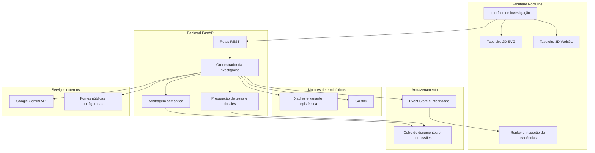
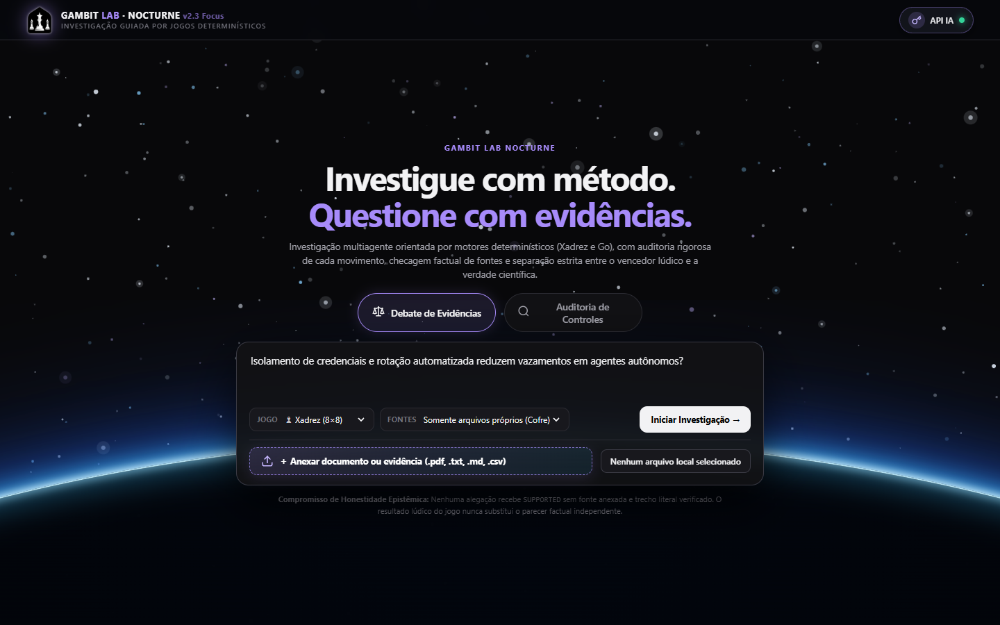
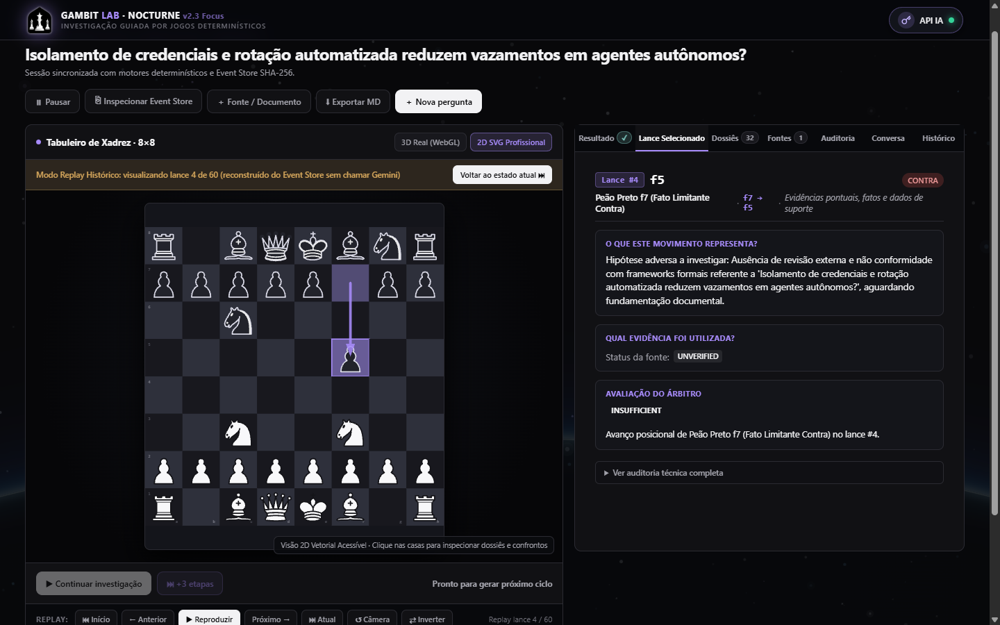
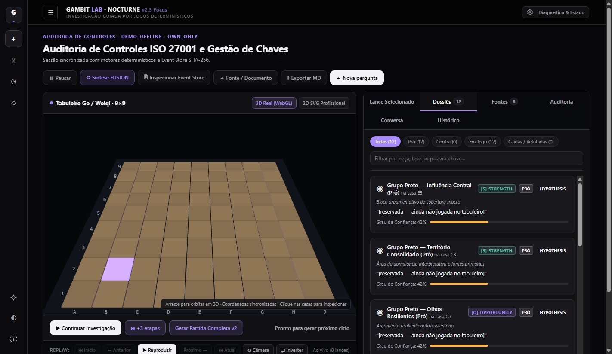
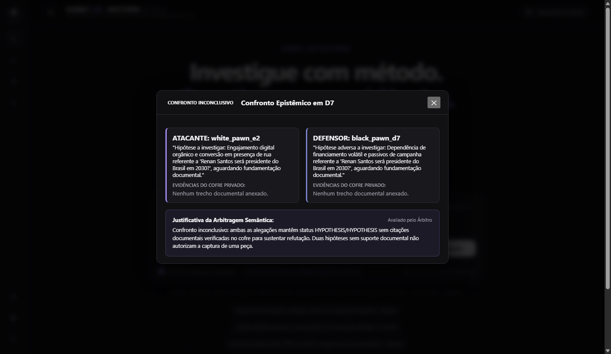
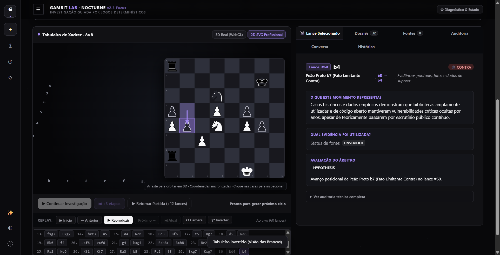

# Gambit Lab

**Framework multiagente orientado por jogos para debates e auditorias baseados em evidências, utilizando LLMs, Xadrez, Go e raciocínio rastreável.**

*Game-Driven Multi-Agent Framework for Evidence-Based Debate and Auditing*

---

> **Estado do projeto**: experimental, em desenvolvimento. As funcionalidades descritas refletem a documentação fornecida; sua disponibilidade e seu funcionamento devem ser confirmados na versão publicada do código.

---

## Visão geral

O Gambit Lab é um framework experimental de raciocínio multiagente orientado por jogos. Sua proposta é combinar modelos de linguagem de grande porte (Large Language Models, ou LLMs), motores determinísticos de Xadrez e Go, análise documental e rastreabilidade de evidências para estruturar debates e auditorias.

Em vez de gerar apenas uma resposta, a arquitetura organiza agentes que investigam pontos de vista diferentes, confrontam alegações, consultam fontes e registram o processo em uma sequência de eventos que pode ser revisitada.

---

## Princípio fundamental

> *O LLM interpreta; as regras do jogo restringem; as evidências sustentam; o árbitro avalia; e o sistema registra.*

Os modelos de linguagem são responsáveis pela interpretação e formulação de argumentos. A legalidade dos movimentos é verificada por motores determinísticos, enquanto as avaliações factuais devem considerar a pertinência, o contexto e a suficiência das evidências.

Uma vitória no tabuleiro não demonstra, por si só, a veracidade de uma tese. Por isso, o resultado do jogo e a conclusão baseada nas evidências são apresentados separadamente.

---

## Modalidades

O Gambit Lab possui duas modalidades principais:

### 1. Debate de Evidências (`debate`)

Investiga questões abertas ou controversas por meio de dois lados argumentativos: Pró e Contra.

- **Teses e subteses**: cada lado apresenta uma tese central e argumentos específicos associados às peças do Xadrez ou às alegações representadas no Go.
- **Dossiês individuais**: as peças podem ser associadas a subteses, fontes e histórico de confrontos.
- **Acesso controlado**: o sistema utiliza permissões para restringir o acesso aos documentos de cada lado e, conforme a configuração, de cada peça.
- **Confrontos semânticos**: o árbitro compara alegações e evidências, distinguindo refutação fundamentada, defesa preservada e confronto inconclusivo.
- **Rastreabilidade**: o usuário pode consultar os movimentos, os argumentos associados e os registros de avaliação.

### 2. Auditoria de Controles (`audit`)

Auxilia na análise de requisitos, riscos e evidências de conformidade de sistemas e processos. A metodologia pode utilizar referências como ISO/IEC 27001, SOC 2, NIST CSF, CIS Controls, LGPD e OWASP, de acordo com o escopo e os documentos disponíveis.

- **Controles e critérios**: os requisitos avaliados possuem critérios explícitos e evidências relacionadas.
- **Achados**: as verificações podem indicar conformidade, não conformidade, atendimento parcial ou ausência de evidências suficientes.
- **Riscos**: a classificação de gravidade deve decorrer de critérios documentados, e não apenas da opinião gerada pelo modelo.
- **Relatórios**: o histórico permite revisar as conclusões e os elementos que as fundamentaram.

---

## Principais componentes

### Xadrez Epistêmico e evidências por peça

O Xadrez Epistêmico é uma variante experimental que utiliza a movimentação do Xadrez como base para confrontos argumentativos. Suas regras adicionais não devem ser confundidas com as regras oficiais da FIDE.

- O Rei representa a tese central; as demais peças representam diferentes subteses e linhas de argumentação.
- Cada peça possui uma identidade e uma relação com os documentos que está autorizada a consultar.
- A seleção de uma peça permite examinar sua tese, seus artefatos e, quando disponível, o estado dos possíveis confrontos.
- Um confronto pode terminar sem refutação, mesmo quando existe uma tentativa de captura geometricamente válida.
- A validação da fonte não é equivalente à comprovação da alegação: a arbitragem precisa examinar o conteúdo e seu contexto.

A implementação deve distinguir movimento legal, confronto permitido pela variante e conclusão factual, registrando cada decisão de maneira rastreável.

### Go 9×9 e análise SWOT

O motor de Go oferece uma estrutura para investigar relações, influência, cobertura de temas e lacunas de evidências.

A análise SWOT organiza os fatores em quatro dimensões:

| Dimensão | Significado |
| :--- | :--- |
| **Forças (Strengths)** | Capacidades e vantagens internas |
| **Fraquezas (Weaknesses)** | Limitações e vulnerabilidades internas |
| **Oportunidades (Opportunities)** | Condições externas favoráveis |
| **Ameaças (Threats)** | Riscos e condições externas desfavoráveis |

*Nota de especificação*: a documentação recebida descreve uma divisão do tabuleiro em quadrantes SWOT. Essa escolha precisa ser confirmada na implementação atual, pois difere da proposta de usar SWOT como classificação semântica sem particionar rigidamente o tabuleiro. Em qualquer abordagem, as regras de captura e pontuação do Go devem permanecer consistentes.

### Arbitragem semântica (`SemanticClashEngine`)

O árbitro avalia se uma evidência realmente sustenta ou contradiz a alegação à qual foi vinculada.

- **Verificação de fonte**: confirma a existência do documento e, quando aplicável, a correspondência do trecho citado.
- **Pertinência**: verifica se a informação aborda o objeto, o período e o contexto relevantes.
- **Confronto**: diferencia alegações contraditórias, compatíveis, incomparáveis ou insuficientemente fundamentadas.
- **Decisão**: registra a justificativa para permitir, rejeitar ou deixar pendente uma captura argumentativa.

Pontuações de confiança, quando utilizadas, exigem metodologia explícita e validação. Faixas numéricas fixas não devem ser apresentadas como probabilidades calibradas sem evidência experimental.

### Event Store e replay

A aplicação registra movimentos, avaliações e outros eventos de investigação, permitindo reconstruir estados históricos sem repetir as chamadas ao LLM.

O uso de hashes SHA-256 e encadeamento de eventos ajuda a detectar alterações nos registros, mas, isoladamente, não torna o armazenamento impossível de adulterar. A verificação completa depende também da gestão confiável dos registros e das referências de integridade.

---

## Arquitetura do sistema



---

## Interface e visualização

A interface Nocturne privilegia o tabuleiro e a análise do movimento selecionado, mantendo detalhes técnicos em áreas secundárias.

Os elementos previstos incluem:
- Tabuleiro de Xadrez em 2D (SVG) e 3D (WebGL).
- Tabuleiro de Go 9×9.
- Histórico de movimentos com reprodução e inspeção contextual.
- Subteses e artefatos associados às peças.
- Visualização separada do resultado do jogo e da conclusão fundamentada.

---

## Capturas de tela

Os caminhos abaixo foram preservados do repositório:

| Página inicial | Xadrez 2D | Auditoria em Go |
| :---: | :---: | :---: |
|  |  |  |

| Xadrez 3D | Confronto argumentativo | Replay |
| :---: | :---: | :---: |
|  |  |  |

---

## Tecnologias

| Camada | Tecnologias descritas |
| :--- | :--- |
| **Backend** | Python 3.12+, FastAPI, Uvicorn, Pydantic e HTTPX |
| **Xadrez** | python-chess e regras adicionais da variante epistêmica |
| **Go** | Motor determinístico próprio para tabuleiro 9×9 |
| **Persistência** | SQLite e Event Store |
| **Frontend** | HTML5, CSS3, JavaScript, Three.js e SVG |
| **IA** | Google Gemini, com chave fornecida pelo usuário (BYOK) |
| **Fontes públicas** | Adaptadores descritos para Wikimedia e OpenAlex |

A disponibilidade das versões, dos modelos Gemini e dos adaptadores deve ser conferida nos arquivos de configuração e em uma execução real.

---

## Como executar localmente

### Pré-requisitos
- Python 3.12 ou superior.
- Git.
- Navegador atualizado.
- Chave de API do Gemini para executar as funcionalidades que dependem do modelo em modo real.

### 1. Clonar o repositório
```bash
git clone https://github.com/Lucas-715/Gambit-Lab.git
cd Gambit-Lab
```

### 2. Criar e ativar um ambiente virtual

**Windows — PowerShell:**
```powershell
python -m venv .venv
.\.venv\Scripts\Activate.ps1
```

**Linux e macOS:**
```bash
python3 -m venv .venv
source .venv/bin/activate
```

### 3. Instalar as dependências
```bash
python -m pip install -r requirements.txt
```

### 4. Configurar a chave Gemini

Crie seu arquivo local de configuração copiando `.env.example`.

**Windows — PowerShell:**
```powershell
Copy-Item .env.example .env
```

**Linux e macOS:**
```bash
cp .env.example .env
```

Edite o `.env` com a sua própria chave:
```ini
GEMINI_API_KEY=sua_chave_aqui
GEMINI_MODEL=gemini-flash-lite-latest
ENVIRONMENT=development
API_HOST=127.0.0.1
API_PORT=8000
```

> **Segurança**: não compartilhe a chave, não a inclua em commits e não envie o arquivo `.env` para o GitHub. O `.gitignore` deve impedir seu versionamento. O modelo configurado precisa ser compatível com os modelos efetivamente disponíveis na conta e na integração utilizada.
>
> **Atenção**: confirme se o backend carrega automaticamente o arquivo `.env` ou se exige a exportação das variáveis para o ambiente. Não pressuponha que apenas criar o arquivo seja suficiente.

### 5. Iniciar a aplicação
```bash
python -m uvicorn services.api.main:app --host 127.0.0.1 --port 8000
```

Acesse `http://127.0.0.1:8000` no navegador.

O documento original descreve um modo `DEMO_OFFLINE` sem chave. Essa funcionalidade deve ser confirmada antes de ser apresentada como disponível; se existir, seus dados precisam ser claramente identificados como demonstrativos.

---

## Testes automatizados

Para executar a suíte indicada na documentação:

```bash
python -m pytest tests/unit tests/integration -v
```

O documento original relata 104 testes aprovados, mas esse resultado não foi reproduzido nesta revisão textual. Antes de publicar, atualize a informação com a execução mais recente e diferencie testes com mocks de testes reais envolvendo Gemini e pesquisa externa.

---

## Organização do repositório

```
Gambit-Lab/
├── apps/
│   └── web/                 # Interface Nocturne
├── docs/
│   ├── adr/                 # Registros de decisões arquiteturais
│   ├── screenshots/         # Capturas de tela
│   ├── REQUIREMENTS.md      # Requisitos
│   └── SPECIFICATION.md     # Especificação
├── packages/
│   ├── contracts/           # Contratos de dados
│   └── game_rules/          # Motores de Xadrez e Go
├── services/
│   └── api/
│       ├── agents/          # Adaptadores de IA e pesquisa
│       ├── fusion/          # Integração multiestratégica
│       ├── match/           # Orquestração e confrontos
│       ├── models/          # Esquemas de dados
│       ├── routes/          # API REST
│       └── storage/         # Cofres, sessões e Event Store
├── tests/
│   ├── integration/
│   └── unit/
├── .env.example             # Exemplo de configuração, sem segredos
├── .gitignore
├── AUDIT_REPORT.md          # Auditoria técnica
├── CHANGELOG.md             # Histórico de mudanças
├── README.md
├── requirements.txt
└── TEST_MATRIX.md            # Matriz de testes
```

Esta árvore resume a estrutura descrita no documento original; confira os nomes e a existência dos arquivos na versão publicada.

---

## Estado do desenvolvimento e limitações

O Gambit Lab é um projeto experimental. Sua hipótese central é que regras formais inspiradas em jogos podem tornar investigações multiagentes mais estruturadas, verificáveis e rastreáveis.

Essa hipótese não comprova, por si só, que o sistema produz respostas mais corretas do que um LLM ou sistema multiagente convencional. Tal conclusão exige avaliação experimental comparativa.

Outras limitações:
- **Arbitragem factual**: a verificação de uma citação não garante que ela sustente a tese. A relevância e a suficiência da evidência podem exigir revisão humana.
- **Regras do jogo**: a variante de Xadrez Epistêmico possui condições adicionais e não equivale integralmente ao Xadrez FIDE.
- **Pesquisa Web**: os provedores configurados podem limitar a cobertura das fontes públicas.
- **Consumo de recursos**: a API Gemini pode envolver custos, limites de taxa e indisponibilidade temporária.
- **Finalidade**: o sistema não substitui assessoria jurídica, auditoria profissional ou previsão eleitoral validada.

---

## Roadmap

A documentação original informa as seguintes frentes de desenvolvimento. Revise os estados com base nos testes atuais antes de marcar qualquer item como concluído.

- [ ] Validar o motor de Xadrez Epistêmico e suas regras especiais.
- [ ] Validar o Go 9×9 e a integração com a análise SWOT.
- [ ] Confirmar permissões individuais de evidências por peça.
- [ ] Validar a arbitragem semântica com fontes pertinentes e contraditórias.
- [ ] Verificar o alinhamento e o funcionamento dos tabuleiros 2D e 3D.
- [ ] Confirmar a sincronização do replay e a rastreabilidade dos eventos.
- [ ] Investigar suporte a modelos locais por Ollama ou vLLM.
- [ ] Avaliar recursos colaborativos com arbitragem humana.
- [ ] Estender a exportação de relatórios, conforme os requisitos do projeto.

---

## Licença e uso

O documento original informa que o projeto é destinado à pesquisa, demonstração arquitetural e portfólio e que todos os direitos estão reservados.

Até a inclusão de uma licença explícita, a disponibilização pública do código não equivale a conceder permissão geral de reutilização ou distribuição. Consulte o responsável pelo projeto para esclarecimentos sobre o uso.
