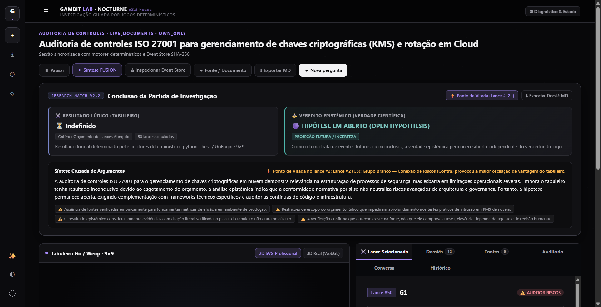
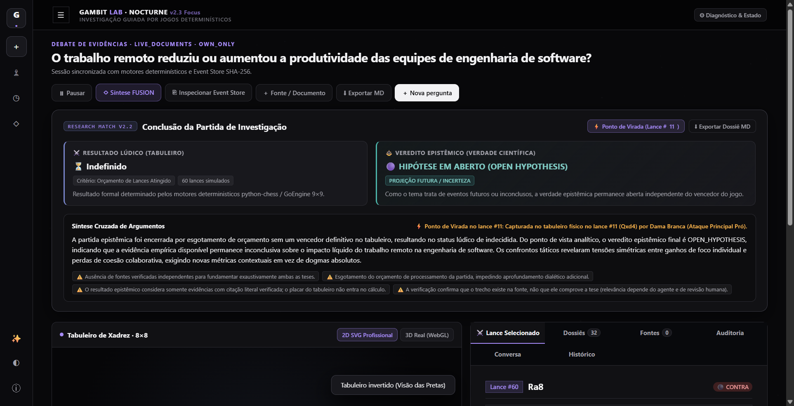

# Gambit Lab Nocturne (v2.5.1 Polish) — Framework Multiagente de Debate & Auditoria Orientado por Jogos

> **Princípio Central**: *O LLM propõe, as regras do jogo restringem, as evidências sustentam e o sistema audita.*

O **Gambit Lab Nocturne** é uma plataforma profissional de investigação, debate epistêmico e auditoria de controles orientada por motores formais de jogos (*Game-Driven Multi-Agent Epistemic & Audit System*). A plataforma estrutura análises rigorosas em sequências procedurais determinísticas:

$$\text{Pergunta / Objeto} \longrightarrow \text{Teses / Requisitos} \longrightarrow \text{Busca / Evidências} \longrightarrow \text{Citação Literal} \longrightarrow \text{Confronto} \longrightarrow \text{Arbitragem / Conformidade} \longrightarrow \text{Event Store SHA-256}$$

---

## 1. Novidades da Versão v2.5 (Redesign & Consolidação de Produto)

- **3D Real (WebGL) como Apresentação Primária**:
  - 3D definido como modo padrão com enquadramento aproximado (`radius = 11.2`, `phi = 0.82`) e botão `↺ Câmera` para restaurar o ponto de vista ideal com um clique.
- **2D SVG Profissional Reconstruído com Peças Cburnett**:
  - Eliminação completa da área morta à esquerda; centralização matemática 1:1; 24 símbolos vetoriais clássicos SVG Cburnett (padrão mundial Lichess/Chess.com) em marfim `#F8F8FA` e obsidiana `#22232B`; rótulos de coordenadas nos cantos periféricos.
- **Painel "Lance Selecionado" Simplificado (Narrativa Única)**:
  - Unificação em narrativa contínua: *O que este movimento representa?*, *Qual evidência foi utilizada?*, *Avaliação do Árbitro*, além de auditoria de controles e telemetria colapsável.
- **Barra de Replay em Pares Numerados (1. e4 e5 ...)**:
  - Formatação oficial de planilha de xadrez com auto-scroll e sincronização instantânea de evidências e tabuleiro.
- **Conclusão Honesta por Esgotamento de Orçamento**:
  - Rotulação explícita `"⏳ Partida não concluída — Orçamento esgotado"` sem inventar vencedor artificial, mantendo o botão de extensão disponível.
- **Simplificação Radical em 2 Modalidades Principais**:
  - **⚖️ Debate de Evidências** (`debate`): Confronto de teses e argumentos favoráveis e contrários com validação estrita de fontes. As capacidades da antiga "Pesquisa Estratégica" (busca Web pública anti-SSRF, cofre privado isolado e FUSION) foram integradas de forma limpa nesta modalidade.
  - **🔍 Auditoria de Controles** (`audit`): Avaliação formal de requisitos de conformidade e governança (ISO 27001, SOC 2, NIST CSF, CIS, LGPD, OWASP), com critérios esperados, achados objetivos, classificação de riscos (`CRÍTICO`, `ALTO`, `MÉDIO`, `BAIXO`) e recomendações técnicas.
- **Identidade Visual Única NOCTURNE**:
  - Eliminação completa do tema azul Cosmic. Paleta estrita profissional: fundo `#08080A`, superfícies `#111114`, elevação `#18181D`, cartões `#202028`, bordas `#2B2B32`, texto `#F2F2F4`, violeta forense `#A78BFA`, sucesso `#5BBFA7`, alerta `#D5A65B`, erro `#D86B75`.
  - Fundo estelar sutil em monocromático com drift suave e parallax proporcional, sem planetas ou nebulas chamativas.
- **Xadrez 2D Profissional SVG como Padrão**:
  - Visualização 2D definida como padrão de abertura (`viewMode = '2d'`).
  - Grade SVG 800×800 matemática perfeita com 64 casas cinza-pedra claro (`#292931`) e grafite profundo (`#18181C`).
  - Símbolos vetoriais de peças nítidos extraídos do Stitch (`#w-pawn`, `#b-king`, etc.), sem dependência de fontes tipográficas externas.
  - Seta vetorial do lance suave em `#A78BFA` com marcador arrowhead.
  - Coordenadas de canto internas (estilo Chess.com / Lichess) para `a..h` e `8..1`.
  - Inversão de perspectiva do tabuleiro com um clique (`#flipBoardBtn` / `isBoardFlipped`).
- **Go 9×9 2D SVG**:
  - Tabuleiro em madeira escura `#1B1B22`, linhas `#33333F`, pontos Hoshi e Tengen.
  - Pedras com gradiente radial e filtro de sombra projetada (`#stoneShadow`).
  - Anel pulsante violeta no último lance jogado.
  - Coordenadas clássicas `A..H, J` (sem a letra `I`) e `1..9`.
- **Replay Bar com Reprodução Automática (Timer) e Notação Clicável**:
  - Botão `#repPlayPauseBtn` reproduz automaticamente os lances da partida a cada 1.5s.
  - Barra de notação clicável (`#replayMovesStrip`) exibindo todos os lances SAN com realce ativo do lance atual.
- **Painel Contextual Adaptativo por Modo**:
  - Modo Debate: Exibe peça, movimento, SAN, tese defendida, citação literal com badge `SOURCE_VERIFIED`, contestação e veredito do árbitro.
  - Modo Auditoria: Exibe requisito normativo (ex.: `ISO 27001 - A.10 / SOC 2 CC6.1`), badge de risco, status de conformidade (`CONFORME`, `NÃO CONFORME`, `PARCIAL`), critério esperado, evidência encontrada, achado e recomendação técnica.
- **Segurança e Higiene de Pacotes (CRÍTICO)**:
  - Script de empacotamento `create_release_zip.py` filtra estritamente `.env` com validação de segurança automatizada, garantindo que credenciais permaneçam estritamente no ambiente local e apenas `.env.example` seja distribuído.
- **Cobertura de Testes**:
  - **90 testes aprovados no Pytest (`90 passed, 0 failed, 1 warning`)**.
  - Suíte E2E via Chrome DevTools Protocol com 4 telas de alta fidelidade capturadas.

---

## 2. Novidades da Reengenharia Nocturne Focus (`v2.3.1`)

- **Rastreabilidade Ponta a Ponta no Painel 'Lance Selecionado'**:
  - População automática do painel no término do carregamento da partida (`loadMatchAndPieces`) com o último lance do timeline, eliminando painéis em branco.
  - Sincronização estrita de todos os lances (`selectMoveByPly`), exibindo número do lance, notação SAN, peça ativa, coordenadas, tese, citação literal, status de verificação e status de captura física.
  - Estado inicial pré-jogo limpo e informativo quando o cursor de replay está no início (`ply = 0`), com desativação apropriada dos botões de recuo.
- **Alinhamento Matemático de Coordenadas 2D e Projeção em 3D**:
  - **Modo 2D**: Estrutura CSS Grid (`.board-2d-inner`) com alinhamento rigoroso 1:1 entre as células do tabuleiro e os rótulos de fileiras (`8..1`) e colunas (`a..h` no Xadrez, `A..J` sem `I` no Go 9×9).
  - **Modo 3D**: Overlay em HTML5 Canvas (`#stageCoordsOverlay`) sincronizado com o WebGL através da projeção geométrica da matriz de visualização e perspectiva (`vp`).
- **Inspeção Interativa por Clique na Casa**:
  - Clique em qualquer casa do tabuleiro abre modal de inspeção com busca no histórico da partida e botão direto para inspecionar o lance correspondente no painel "Lance Selecionado".
- **Honestidade Científica nas Citações e Vereditos**:
  - Distinção transparente entre citação verificada no arquivo ("✓ Citação verificada no arquivo") e citação anexada sem verificação ("⚠️ Citação anexada; relevância semântica pendente").
  - Capturas físicas nunca geram falsos vereditos `REFUTED` no histórico, mantendo neutralidade factual (`INCONCLUSIVE`).
- **Research Match v2 (`services/api/match/`)**:
  - Geração de partidas completas orientadas por 7 estágios determinísticos.
  - Investigação Pró e Contra estritamente isoladas em cofres privados (HTTP 403).
  - Dossiês argumentativos para cada peça (`PieceDossierSchema`), com glifo, papel, tese, evidências e barra de confiança.
  - Simulação lúdica completa via `python-chess` e `GoEngine9x9` até regras formais de encerramento (xeque-mate, resignação por déficit $\ge 800\text{ cp}$, dois passes consecutivos ou esgotamento explícito de orçamento).
  - Desacoplamento estrito entre Resultado Lúdico (tabuleiro) e Veredito Epistêmico (verdade científica baseada em evidências).
  - Detecção determinística de Ponto de Virada (`turning_point_ply`) e navegação no histórico via replay SHA-256.
- **Fundo Estelar Vivo & Experiência Nocturne**:
  - Canvas estelar em 3 camadas de profundidade com drift contínuo suave, mouse parallax interpolado e alternador de movimento (`#motionBtn`).
  - 5ª Aba Analítica **Peças & Teses** (`#tabPanelPieces`) com filtros dinâmicos e inspeção clicável nas casas do tabuleiro 2D/3D.
- **Descoberta Real de Capacidades (`GET /api/v1/capabilities`)**: Expõe em tempo real a disponibilidade do Google Gemini e da Pesquisa Web pública, políticas ativas e orçamento padrão de etapas.
- **Pesquisa Web Pública Opt-In com Anti-SSRF (`WebSearchAdapter`)**: Políticas explícitas `OWN_ONLY` (zero chamadas externas), `WEB_ONLY` e `HYBRID`, consultando fontes públicas HTTPS (OpenAlex + Wikimedia/Wikipedia + snapshots HTTPS validados) com bloqueio anti-SSRF estrito (`localhost`, RFC 1918, `169.254.169.254`, redirecionamentos e esquemas não-HTTPS) e registro `SHA-256`.
- **Progressão Contínua sem Limite Artificial de 3 Lances (`POST /api/v1/sessions/{id}/advance`)**: Investigações avançam continuamente por 10+ lances legais em Xadrez 8×8 e Go 9×9 (padrão 12 etapas, configurável até 60), com `Idempotency-Key`, concorrência otimista (`expected_version` → `409 Conflict`) e controles `/pause`, `/resume` e `/cancel`.
- **Separação Semântica entre Avanço e Replay**:
  - **`▶ Continuar investigação`**: Executa novo ciclo real de pesquisa/arbitragem e aplica lance validado pelo motor determinístico.
  - **`Replay histórico` (`GET /api/v1/sessions/{id}/replay?up_to_seq=N`)**: Reconstrói qualquer posição histórica do `EventStore` com **zero chamadas ao LLM**.
- **Honestidade Radical de Execução e Telemetria**:
  - Modos explícitos: `DEMO_OFFLINE`, `LIVE_DOCUMENTS`, `LIVE_WEB` e `LIVE_HYBRID`.
  - Extração real de `usageMetadata` (`prompt_tokens`, `completion_tokens`, `tokens`) e `latency_ms` nas chamadas Gemini; `Não medido` quando offline.
  - Proibição de fallback silencioso `LIVE → DEMO` em erros `HTTP 429` / `503`.
  - Nenhuma alegação recebe `SUPPORTED` sem fonte anexada/recuperada e trecho literal verificado nos bytes do artefato (`DocumentVault.find_verified_quote_offset`).
- **Identidade Visual Gambit Lab Nocturne**: Paleta de alto contraste (`#040405` / `#0B0C0F` / `#A68DFF`), alternância de tema `Nocturne / Cosmic`, WebGL 3D procedural nativo preservado + tabuleiro **2D Acessível (WCAG AA)** e 4 abas analíticas (`Conversa`, `Fontes`, `Auditoria`, `Histórico`).

---

## 3. Capturas Reais Verificadas v2.5 (Nocturne Redesign)

| Home Simplificada (2 Modos) | Debate de Evidências (Xadrez 2D SVG) | Auditoria de Controles (Go 9×9 SVG) |
| :---: | :---: | :---: |
|  |  |  |

| Perspectiva Invertida (Flip Board) | Replay com Rastreabilidade de Lances |
| :---: | :---: |
|  |  |

---

## 4. Capturas Anteriores Verificadas (v2.3)

| Home Conversacional Nocturne | Workspace Xadrez 3D (6+ Lances) | Workspace Go 9×9 + Auditoria 3 Camadas |
| :---: | :---: | :---: |
|  |  |  |

---

## 3. A Matriz 3×2 de Aplicações e Pesquisa FUSION

Modalidade e Jogo são duas dimensões ortogonais e independentes (**ADR-001**):

| Modalidade \ Jogo | Xadrez (8×8 — `python-chess`) | Go / Weiqi (9×9 — `GoEngine9x9`) |
| :--- | :--- | :--- |
| **Pesquisa (`research`)** | Gambitos e linhas estratégicas orientam busca central, contraponto e exploração de hipóteses. | Cobertura temática, expansão por influência e aprofundamento territorial de fontes. |
| **Debate (`debate`)** | Confronto de evidências com **capturas condicionadas** pelo árbitro factual e cofres privados isolados (`HTTP 403`). | Disputa territorial com contestação de teses; pretas iniciam; captura por liberdades e avaliação factual separada. |
| **Auditoria (`audit`)** | Peças representam controles, testes e riscos; confrontos expõem lacunas de conformidade. | Regiões representam requisitos normativos, achados verificados e lacunas (`HYPOTHESIS` / `INSUFFICIENT`). |

### Pesquisa FUSION (`POST /api/v1/sessions/{id}/fusion`)
Combina de 1 a 3 estratégias simultâneas com **isolamento estrito de tabuleiros** (sem misturar estados de jogo incompatíveis) e **deduplicação criptográfica de fontes por `SHA-256`** antes da síntese unificada (`CONVERGENT`, `CONTRADICTORY`, `DIFFERENT_SCOPE`, `INSUFFICIENT`).

---

## 4. Estrutura do Repositório e Entregáveis de Engenharia

```text
Gambit_Lab/
├── apps/
│   └── web/index.html             # UI Gambit Lab Nocturne (WebGL 3D procedural + 2D WCAG AA)
├── services/
│   └── api/
│       ├── agents/
│       │   ├── gemini_adapter.py      # Adaptador Gemini real (usageMetadata, retries 429/503) + DEMO_OFFLINE honesto
│       │   └── web_search_adapter.py  # Busca pública HTTPS (OpenAlex / Wikimedia) + proteção Anti-SSRF
│       ├── fusion/pipeline.py         # Orquestrador FUSION com isolamento de ramos e deduplicação SHA-256
│       ├── models/schemas.py          # Contratos Pydantic v2.1 (Capabilities, Advance, 3 Camadas Epistêmicas)
│       ├── routes/                    # /capabilities, /sessions, /advance, /artifacts, /fusion, /replay, /reports
│       └── storage/                   # SessionManager, EventStore SHA-256 encadeado e DocumentVault
├── packages/
│   └── game_rules/                # EpistemicChessEngine (python-chess) e GoEngine9x9
├── tests/
│   ├── unit/                      # Testes dos motores FIDE/Go, EventStore e FUSION
│   ├── integration/               # Matriz 3x2, segurança, camadas epistêmicas e AT-01..AT-24 Nocturne
│   └── live/                      # Testes ponta a ponta reais com Google Gemini e LIVE_WEB
├── docs/screenshots/              # Capturas Desktop e Mobile verificadas via Chromium CDP
├── AUDIT_REPORT.md                # Relatório técnico completo da auditoria (file:line, causas e correções)
├── MIGRATION_PLAN.md              # Plano de migração controlada e máquina de estados
├── TEST_MATRIX.md                 # Matriz de rastreabilidade dos 66 testes automatizados
└── CHANGELOG.md                   # Histórico detalhado de versões
```

---

## 5. Como Executar Localmente

### Pré-requisitos
- Python 3.12+

### Passo 1: Criar e ativar o ambiente virtual
```powershell
# Windows (PowerShell)
python -m venv .venv
.\.venv\Scripts\Activate.ps1
pip install -r requirements.txt
```

### Passo 2: Configurar variáveis de ambiente
```powershell
Copy-Item .env.example .env
```
- **Modo `DEMO_OFFLINE` (sem chave)**: Funciona imediatamente sem configurar `GEMINI_API_KEY`, rotulando todas as sessões de forma transparente como `DEMO_OFFLINE`.
- **Modos `LIVE_DOCUMENTS` / `LIVE_WEB` / `LIVE_HYBRID`**: Preencha `GEMINI_API_KEY` no arquivo `.env` local (ignorado pelo Git). A chave nunca é enviada ao navegador.

### Passo 3: Iniciar o servidor FastAPI
```powershell
.\.venv\Scripts\python.exe -m uvicorn services.api.main:app --host 127.0.0.1 --port 8000 --reload
```
Acesse:
- **Aplicação Web Nocturne (3D WebGL + 2D WCAG)**: http://127.0.0.1:8000/
- **Capacidades Ativas JSON**: http://127.0.0.1:8000/api/v1/capabilities
- **Documentação OpenAPI / Swagger**: http://127.0.0.1:8000/docs

---

## 6. Executando a Suíte Completa de Testes (66 Testes)

```powershell
# Suíte completa (Unitários + Integração + AT-01..AT-24 + Live Gemini/Web):
.\.venv\Scripts\python.exe -m pytest tests/unit tests/integration tests/live -v
```

Consulte [AUDIT_REPORT.md](AUDIT_REPORT.md) e [TEST_MATRIX.md](TEST_MATRIX.md) para o detalhamento individual dos 66 testes.

---

## 7. Principais Endpoints REST (`v2.1.0-nocturne`)

| Método | Rota | Descrição |
| :--- | :--- | :--- |
| `GET` | `/api/v1/capabilities` | Estado real do Gemini, Pesquisa Web, políticas e limites. |
| `POST` | `/api/v1/sessions` | Cria sessão (`mode`, `game`, `source_policy`, `max_steps`, `force_demo`). |
| `GET` | `/api/v1/sessions/{id}` | Estado completo da sessão, contadores separados, claims, artefatos e eventos. |
| `POST` | `/api/v1/sessions/{id}/advance` | Avança 1..5 etapas reais da investigação (`expected_version`, `Idempotency-Key`). |
| `POST` | `/api/v1/sessions/{id}/pause` | Pausa a sessão em andamento. |
| `POST` | `/api/v1/sessions/{id}/resume` | Retoma uma sessão pausada. |
| `POST` | `/api/v1/sessions/{id}/cancel` | Cancela formalmente a sessão. |
| `POST` | `/api/v1/sessions/{id}/artifacts` | Ingere documento no cofre (`public`, `white` ou `black`) com hash `SHA-256`. |
| `POST` | `/api/v1/sessions/{id}/artifacts/web-snapshot` | Captura snapshot HTTPS público auditável com proteção Anti-SSRF. |
| `GET` | `/api/v1/sessions/{id}/replay` | Replay determinístico integral ou parcial (`?up_to_seq=N`) sem chamadas ao LLM. |
| `POST` | `/api/v1/sessions/{id}/fusion` | Executa Pesquisa FUSION multi-estratégia com deduplicação `SHA-256`. |
| `GET` | `/api/v1/sessions/{id}/reports` | Exporta dossiê fiel da sessão em `json` ou `markdown`. |

---

## 8. Licença
Distribuído sob a licença MIT.
