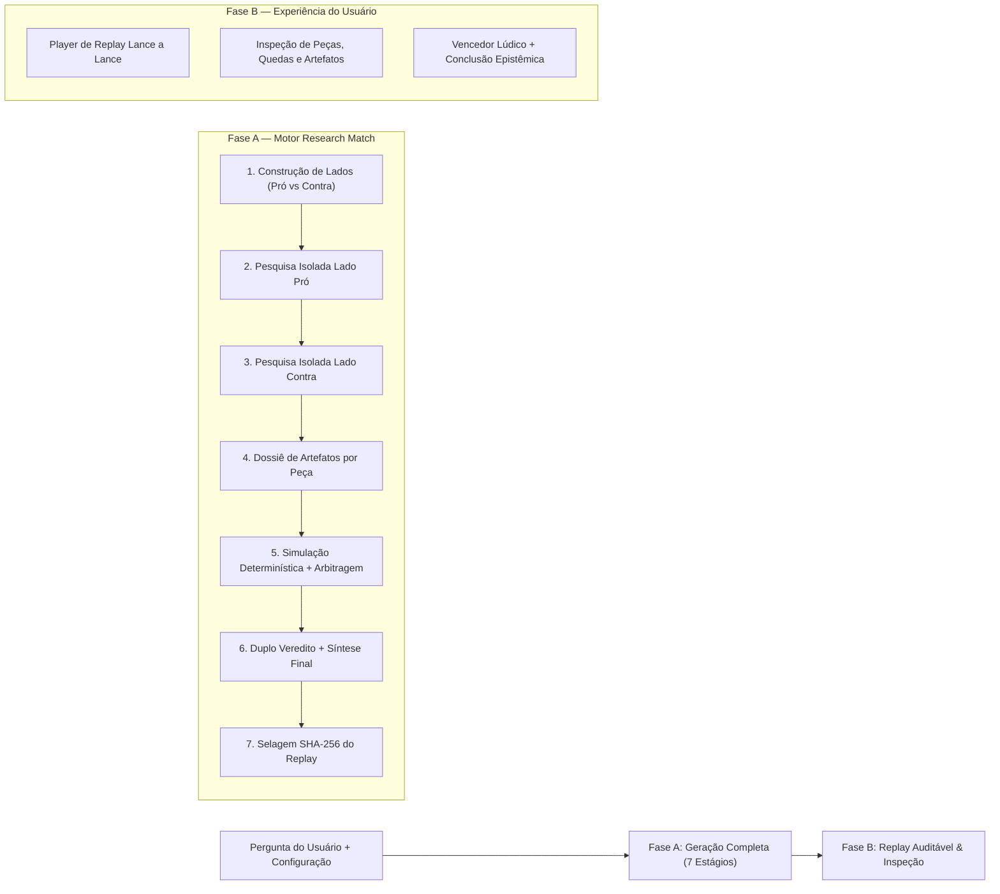

# Gambit Lab Nocturne v2.2 — Especificação de Reengenharia: *Research Match* (Partida Completa Pró vs Contra, Dossiê por Peça e Replay Auditável)

**Status:** Especificação Oficial Implementada (`v2.2.0-research-match`)  
**Escopo:** Evolução estrutural do modo de investigação de "avanço manual inconclusivo" para **Geração Completa de Partida Auditável (*Research Match*)** com pesquisa isolada Pró vs Contra, dossiês de artefatos por peça, encerramento por critério formal, duplo resultado (Lúdico + Epistêmico), replay interativo e fundo espacial vivo com parallax sutil.

---

## 1. Nova Arquitetura do Modo Pesquisa (*Research Match*)

O sistema passa a operar em **duas fases claramente separadas**:



### Componentes Preservados
- Motores determinísticos `EpistemicChessEngine` (`python-chess`, FIDE + captura condicionada) e `GoEngine9x9` (captura por liberdades, proibição de suicídio, superko posicional e contagem por área com `komi = 6.5`).
- `EventStore` imutável encadeado por `SHA-256` e `DocumentVault` com isolamento por `owner_side` (`HTTP 403`).
- `WebSearchAdapter` HTTPS com proteção Anti-SSRF estrita e `GeminiAdapter` com extração real de `usageMetadata` (sem fallback silencioso `LIVE → DEMO`).
- Renderizador WebGL 3D procedural nativo + tabuleiro 2D Acessível (WCAG AA).
- Endpoint legado `POST /api/v1/sessions/{id}/advance` preservado para compatibilidade retroativa e controle manual opcional.

---

## 2. Fluxo Completo Pró vs Contra e Isolamento de Preparação

1. **Decomposição Polarizada Honesta**:
   - **Lado Pró** (`white` no Xadrez / `black` no Go): Formula e investiga a tese afirmativa/favorável (evidências de viabilidade, ganhos comprovados, marcos técnicos e dados de sustentação).
   - **Lado Contra** (`black` no Xadrez / `white` no Go): Formula e investiga a antítese/ceticismo metodológico (fragilidades, riscos estruturais, contraprovas, limites empíricos e cenários alternativos).
2. **Isolamento Estrito de Cofres (`Golden Rule`)**:
   - Durante os estágios de preparação (`1..4`), as fontes recuperadas pelo Lado Pró são gravadas no cofre `owner_side = pro_color`, e as fontes do Lado Contra são gravadas no cofre `owner_side = contra_color`.
   - Nenhum lado tem acesso aos artefatos internos do adversário durante a formulação de seus dossiês.
   - Durante a partida (`Estágio 5`), apenas os argumentos e citações efetivamente **jogados no tabuleiro** entram em disputa pública (`played_at_ply = k`); artefatos não acionados permanecem como reserva interna até a abertura da auditoria pós-partida (`is_complete = True`).

---

## 3. Modelo de Dados das Peças e Artefatos (`PieceDossierSchema`)

Cada peça no Xadrez (ou grupo estratégico no Go 9×9) constitui uma unidade argumentativa rastreável:

### Papéis Argumentativos no Xadrez (8×8)
| Peça | Papel Argumentativo (`role`) | Função na Partida |
| :--- | :--- | :--- |
| **Rei (`♔`/`♚`)** | Tese central do lado | Núcleo axiomático que o lado protege; sua queda (xeque-mate) encerra o tabuleiro. |
| **Dama (`♕`/`♛`)** | Principal linha de ataque argumentativo | Argumento de maior alcance combinando evidência direta e síntese crítica. |
| **Torres (`♖`/`♜`)** | Argumentos estruturais e institucionais | Pilares normativos, arquiteturais ou regulatórios de longo alcance. |
| **Bispos (`♗`/`♝`)** | Interpretações conceituais e leitura de contexto | Análises diagonais de escopo, comparabilidade e premissas metodológicas. |
| **Cavalos (`♘`/`♞`)** | Argumentos não lineares e conexões inesperadas | Contrapontos táticos capazes de saltar bloqueios argumentativos convencionais. |
| **Peões (`♙`/`♟`)** | Evidências pontuais, fatos e dados de suporte | Observações empíricas atômicas que abrem espaço e sustentam a estrutura. |

### Blocos Argumentativos no Go / Weiqi (9×9)
| Bloco (`piece_type`) | Papel Argumentativo (`role`) |
| :--- | :--- |
| **`go_influence`** | Bloco de influência central e cobertura macro da tese. |
| **`go_territory`** | Território consolidado de dominância interpretativa e fontes primárias. |
| **`go_eyes`** | Argumento resiliente autossustentado (duplo suporte independente). |
| **`go_invasion`** | Invasão tática: contra-argumento inserido em território adversário. |
| **`go_siege`** | Cerco argumentativo: pressão sobre premissas adversárias com poucas liberdades. |
| **`go_connection`** | Conexão estrutural articulando evidências distribuídas. |

### Contrato Formal `PieceDossierSchema`
```json
{
  "piece_id": "white_queen_d1",
  "side": "pro",
  "color": "white",
  "piece_type": "queen",
  "symbol": "♕",
  "label": "Dama Branca (Linha Principal Pró)",
  "role": "Principal linha de ataque argumentativo",
  "initial_coord": "d1",
  "current_coord": "h5",
  "alive": true,
  "captured_at_ply": null,
  "captured_by_piece_id": null,
  "fall_explanation": null,
  "claim": "Arquiteturas com motores determinísticos externos reduzem falhas de execução autônoma.",
  "supporting_artifacts": [
    {
      "artifact_id": "...",
      "title": "NIST AI RMF 1.0",
      "sha256": "...",
      "owner_side": "white",
      "quote_text": "controles determinísticos externos ao modelo...",
      "verified": true,
      "played_at_ply": 3
    }
  ],
  "counter_artifacts": [],
  "confidence_score": 0.84,
  "epistemic_status": "SUPPORTED",
  "history": []
}
```

---

## 4. Regras de Término e Duplo Resultado Final

A partida não é interrompida arbitrariamente sem conclusão. O motor conduz a investigação conforme a profundidade escolhida (`quick`: ~12 lances, `standard`: ~18 lances, `deep`: ~24 lances, estendendo-se até estabilização tática) e encerra formalmente por um de **três critérios**:

1. **`BOARD_VICTORY` (Vitória no Tabuleiro)**:
   - Xeque-mate FIDE, impasse formal de captura sob xeque, colapso estrutural decisivo no Xadrez, ou encerramento territorial por 2 passes consecutivos com contagem oficial de área (`komi = 6.5`) no Go 9×9.
2. **`EPISTEMIC_VICTORY` (Vitória Epistemológica)**:
   - Um dos lados acumula predominância consistente de evidências verificadas (`SOURCE_VERIFIED` / `SUPPORTED`), neutralizando as linhas adversárias sem refutação equivalente.
3. **`DRAW_INCONCLUSIVE` (Empate / Inconclusão Honesta)**:
   - Evidências equilibradas entre Pró e Contra, ausência/insuficiência de fontes verificadas (`0` artefatos), ou pergunta prospectiva sobre evento futuro não decidível factualmente (ex.: eleições de 2030).

### Separação Obrigatória entre Resultado Lúdico e Resultado Epistêmico
- **`ludic_result`**: `WHITE_WINS` (`1-0` / `W+X.5`) | `BLACK_WINS` (`0-1` / `B+X.5`) | `DRAW` (`1/2-1/2`).
- **`epistemic_result`**:
  - `PRO_THESIS_SUPPORTED` — *Tese Pró mais sustentada pelas evidências verificadas*
  - `CONTRA_THESIS_SUPPORTED` — *Tese Contra mais sustentada / Tese principal refutada*
  - `INCONCLUSIVE` — *Inconclusivo (evidências equilibradas ou insuficientes)*
  - `OPEN_HYPOTHESIS` — *Hipótese ainda aberta (ausência de fontes primárias ou projeção futura)*

> **Invariante de Honestidade Intelectual:** Mesmo quando um lado vence ludicamente no tabuleiro (ex.: vantagem territorial no Go com `komi`), o `epistemic_result` **jamais** declara `PRO_THESIS_SUPPORTED` ou `CONTRA_THESIS_SUPPORTED` se não houver fontes verificadas com citação literal ou se o tema for uma projeção futura aberta.

---

## 5. Requisitos Funcionais e Não Funcionais (`v2.2`)

- **`RF-V2-01`**: Decompor toda pergunta de pesquisa em `pro_thesis` e `contra_thesis` explícitas.
- **`RF-V2-02`**: Executar pesquisa independente por lado com cofres `white` e `black` isolados durante a preparação.
- **`RF-V2-03`**: Vincular dossiê formal (`PieceDossierSchema`) a todas as peças/grupos ativos com cálculo transparente de `confidence_score` e `epistemic_status`.
- **`RF-V2-04`**: Simular a partida completa em motores determinísticos (`python-chess` / `GoEngine9x9`), arbitrando confrontos e capturas conforme superioridade probatória.
- **`RF-V2-05`**: Expor progresso real em 7 estágios para acompanhamento visual antes da abertura do replay.
- **`RF-V2-06`**: Emitir `MatchConclusionSchema` contendo resultado lúdico, resultado epistêmico, `turning_point_ply` e síntese final auditável.
- **`RF-V2-07`**: Permitir replay interativo completo (`0..N` lances, autoplay, pausa, salto para ponto de virada e inspeção de peça clicada).
- **`RNF-V2-01` (Eficiência de Cota)**: Em modos `LIVE_*`, consolidar a geração por lado e síntese final em chamadas estruturadas enxutas (máx. 3 chamadas Gemini por partida completa), extraindo `usageMetadata` real acumulado.
- **`RNF-V2-02` (Fundo Vivo Acessível)**: Animação espacial em 3 camadas de parallax sutil (`< 0.18 px/frame`), baixa opacidade, pausa automática com `prefers-reduced-motion: reduce`, redução automática em telas mobile e botão explícito de alternância.

---

## 6. Contratos REST da API (`v2.2`)

| Método | Endpoint | Função |
| :--- | :--- | :--- |
| `POST` | `/api/v1/sessions/{id}/match/stage` | Executa o próximo estágio (`1..7`) da geração da partida completa e retorna o progresso atualizado (`ResearchMatchStateSchema`). |
| `POST` | `/api/v1/sessions/{id}/match` | Executa todos os estágios pendentes (`1..7`) até a conclusão completa da partida e retorna o resultado final + timeline de replay. |
| `GET` | `/api/v1/sessions/{id}/match` | Retorna o estado completo do `ResearchMatch` (`stages`, `pieces`, `timeline`, `conclusion`). |
| `GET` | `/api/v1/sessions/{id}/pieces` | Lista os dossiês por peça (`?viewer_side=white\|black` aplica redação de reserva interna antes do término da partida). |

---

## 7. Redesign Visual Nocturne v2

1. **Fundo Espacial Vivo com Parallax Sutil**:
   - 3 camadas de profundidade estelar com deriva lenta vetorial distinta, cintilação discreta de baixa frequência, leve resposta parallax ao ponteiro e planetas quase estacionários.
   - Controles de acessibilidade: respeita `prefers-reduced-motion` e oferece botão na barra lateral para pausar/ativar o movimento estelar.
2. **Tela de Progresso em 7 Estágios**:
   - Exibida durante a Fase A com barra percentual real, indicadores de estágio concluído/em andamento e resumo ao vivo das teses e fontes encontradas.
3. **Workspace de Replay Auditável (Fase B)**:
   - **Card Superior de Conclusão & Duplo Veredito**: Exibe vencedor lúdico, conclusão epistêmica, síntese final e botão **`⚡ Ver Ponto de Virada`**.
   - **Player Completo de Replay**: `⏮ Início`, `← Anterior`, `▶ Reproduzir / ⏸ Pausar`, `Próximo →`, `⏭ Final` + slider contínuo de lances.
   - **Nova Aba `Peças & Teses` (5 abas analíticas: `Síntese & Conversa`, `Peças & Teses`, `Fontes Pró/Contra`, `Auditoria`, `Histórico`)**: Permite filtrar peças vivas vs capturadas, inspecionar artefatos de cada peça e entender exatamente por que uma peça caiu.

